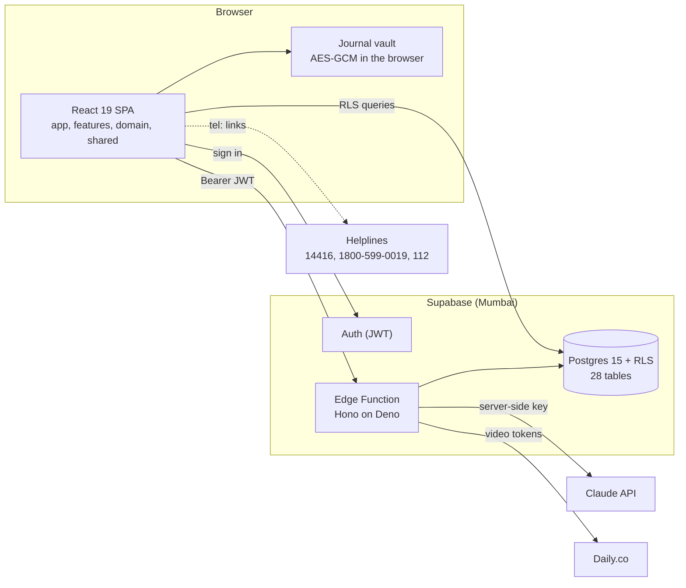

# MindSahaay

A privacy-first, educational wellbeing platform for Indian university students. It offers mood tracking, self-assessments (PHQ-4, PHQ-9, GAD-7), an AI companion in English, Hindi and Hinglish, an encrypted journal, counsellor booking and moderated peer circles. A crisis safety path (Tele-MANAS 14416, KIRAN 1800-599-0019, emergency 112) is built into every free-text feature.

Stack: React 19, Vite, Tailwind CSS v4, TypeScript, Supabase (Auth, Postgres with row level security, Edge Functions), Claude API through a server proxy.

> **Disclaimer.** MindSahaay is a student capstone project. It is educational. It is **not a medical device**, it does not diagnose or treat any condition, and it is not a substitute for a doctor, counsellor or emergency service. It has had **no clinical review** and **no real-user study**. If you or someone you know is in danger, call **112**, or call **Tele-MANAS 14416** or **KIRAN 1800-599-0019** (both 24/7).

## Honest status

Last updated 2026-11-27 (demo-data and persistence change set, docs/31 and docs/32). Full detail is in [docs/02-srs.md](docs/02-srs.md) (traceability matrix) and [docs/19-known-limitations.md](docs/19-known-limitations.md).

Quality gates (2026-11-27): 0 TypeScript errors; 0 ESLint errors and 0 warnings on `src`; **Vitest: 80 files passed and 1 skipped (81), 910 tests passed and 1 skipped** (the skipped one is the live smoke test that needs tokens); coverage statements 90.02%, branches 82.22%, functions 87.34%, lines 91.99% (scope `src/domain` and `src/features`; thresholds in `vitest.config.ts` are enforced). **Playwright, default run (`npx playwright test`): 102 passed**, Chromium only: 93 in the `chromium` project (57 axe accessibility combinations = 14 routes x light/dark x 1280 px/375 px with zero serious or critical violations, plus journeys, smoke and offline-UI specs) and 9 in the `pwa` project. **Real-backend Playwright (`pnpm test:e2e:real`, needs the local Supabase stack): 10 passed** before the demo-data specs were added (more specs are being added, see `e2e/real`; covering sign-in and route sweep, the crisis follow-through loop with security attempts, offline mood and crisis outbox, a shared-device case); two consecutive green runs by a worker and one by the lead. **pgTAP on a real local Postgres (Supabase CLI, Docker): 15 files, 184 tests, all passing** (migrations 0001 to 0009). Production build green; first route about 190.9 KB gzipped (budget 200 KB). Lighthouse and OWASP ZAP have **not** been run. Firefox, WebKit and real-device PWA install are **not** tested. Hosted Supabase, the Anthropic chat route and Daily.co video are **not verified**. Requirements matrix (`node scripts/req-status.mjs`): Implemented 3, Partial 65, Not started 9 of 77.

**Two features were chosen by an AI "courtroom tournament"** (six AI advocate agents, one AI judge, two elimination rounds, rubric weights 30/20/20/20/10) and then built: the **Crisis Follow-Through Loop** and **Lifeline Offline**. The full record is [docs/30-feature-selection-tournament.md](docs/30-feature-selection-tournament.md).

**Quality-assurance story.** Running the system, not just reading it, found real defects, each fixed with a regression test: a permissive RLS policy that let students resolve their own crisis events; six SQL defects visible only on a real Postgres (two were RLS infinite recursions, [docs/21](docs/21-sql-audit.md)); a global CSS class collision (`.p-0` to `.p-5` confetti classes versus Tailwind padding) that made the counsellor's Acknowledge button unclickable; offline crisis events delayed behind a network consent lookup; offline mood check-ins that were never queued (TanStack Query pauses mutations offline); an empty Supabase Realtime publication, so the counsellor queue never updated live (migration 0008); one PHQ-9 item 9 creating two risk events (the database trigger is now the single source of truth); a Vite dev-server crash on Playwright trace files; account erasure that left the offline queue behind; a logout dialog that could trap a student in distress; a status card that said a counsellor had been told when none could see the alert; an update toast that was built but not mounted; and the findings of an independent review ([docs/28](docs/28-new-features-security-review.md)), including a Critical one (a reopened event never re-escalated), fixed in migration 0007. A hand-made mutation check broke three safety-critical lines and the tests caught each break.

| Feature | Status |
|---|---|
| Sign-in (magic link, Google SSO), onboarding with per-purpose consent | Implemented. Magic-link sign-in was checked against a local Supabase (through the local mail catcher it lands on `/dashboard` with no console errors). Google SSO untested. No password sign-in. The 18+ checkbox is a client-side gate and is not stored in the schema |
| Mood check-in with crisis check on notes | Implemented (1 to 10 scale; no edit or delete in the client) |
| Demo data button, no fabricated data, real data is saved ([docs/31](docs/31-demo-data.md), [docs/32](docs/32-persistence-audit.md), migration 0009) | Built. A new account shows empty states with real zeros. Settings > Load demo data inserts about 30 days of sample check-ins and 3 sample screenings into the user's own account, flagged `is_demo` and labelled Demo; Clear demo data removes only those rows. Demo rows are hidden from counsellors, excluded from institution aggregates and never raise a crisis event (pgTAP file 15, 38 tests, local Supabase). About 15 save flows were fixed so success is shown only after a confirmed write. **Open owner decisions:** chat conversations are not saved, stories have no likes table, CBT, worry-time and safety-card anchors are device-only, and the Settings export still reads `localStorage`. See [docs/19](docs/19-known-limitations.md) L54 to L59. Browser-level checks: see `e2e/real` |
| PHQ-4, PHQ-9, GAD-7 with educational disclaimers; PHQ-9 item 9 triggers the crisis card | Implemented and unit tested |
| Multilingual crisis lexicon (English, Hindi, Hinglish) | Implemented. Heldout recall 0.70 on synthetic data, below the 0.95 target. The server copy is generated from the client lexicon (`scripts/sync-lexicon.mjs`) and agrees with it on all 600 dataset rows |
| LLM risk classification and hybrid crisis detection | Code written, **not evaluated** (LLM-only and hybrid results pending an API key; the scripts were verified against a mock server only) |
| AI companion chat (streaming, output guard, rate limit) | Front end and edge function tested with mocks. The output guard runs on the server before any text is shown. The real Claude route is **not verified** (needs `ANTHROPIC_API_KEY`) |
| Encrypted journal and CBT toolkit (AES-256-GCM, passphrase, recovery code) | Implemented and unit tested. CBT records, safety-card anchors and the trusted contact are stored only as ciphertext under opaque keys and are unreadable while the vault is locked (browser-verified); the safety card still shows helplines while locked |
| Consent ledger, JSON export, erase account | Implemented. Export returns the caller's own data (identity from the token, verified through the API against the real edge runtime). One `clearAllLocalUserData()` runs on logout and erase |
| Counsellor directory, booking, cancellation, video token | Directory and slots show real seeded data from a local database (manual browser check). Booking concurrency not exercised. Daily.co video tokens **not verified** (need `DAILY_API_KEY`) |
| Peer circles, posting, reporting, moderator queue | Implemented in components; RLS covered by local pgTAP |
| Counsellor, moderator and admin portals at `/counsellor`, `/moderator`, `/admin` | In demo mode these are **static sample pages**. For a real session `/counsellor` and `/admin` mount the API-backed dashboards and `/moderator` still renders `ModeratorPortal`. Not checked with live data |
| Database: 28 tables, RLS on all, triggers, k-anonymity views (k = 10), 9 migrations, 15 pgTAP files | **Executed on a local Supabase** (CLI 3.2.0, Docker): migrations 0001 to 0009 and seed apply, 184 pgTAP tests pass (files 01 to 15). Running it found defects the earlier read-only audit missed (docs/21). **Hosted Supabase has not been tried** |
| Edge function (Hono on Deno) | Runs on the real Supabase edge runtime. Verified with real JWTs: sign-up creates a profile with an alias; PHQ-9 item 9 = 2 stores the assessment and creates a crisis risk event with helplines; the anon key alone gets 401; the export IDOR is closed. `pg_cron` not verified |
| Accessibility | Axe: 57 of 57 combinations pass. No manual keyboard, NVDA or real-device audit; Chromium only |
| Performance | First route about 190.9 KB gzipped (budget 200 KB). **Lighthouse not run**, no load test |
| Crisis Follow-Through Loop ([docs/24](docs/24-crisis-followup.md), migrations 0005 and 0006) | Built. A high or crisis event follows five recorded steps, with overdue in-app notifications, student check-backs at 24 and 72 hours (server-side opt-out), and a warm handoff slot offer. Checked by hand with a student and a counsellor in two browsers against a local Supabase; pgTAP 08 to 11 pass. **In-app only, not monitored 24/7, no service has agreed to answer, timings have no clinical review.** The Critical defect from the independent review (a reopened event was not escalated again) is fixed in migration 0007 with failing-first tests. The handoff and opt-out have unit, pgTAP and UI tests but no real-browser end-to-end check ([L50](docs/19-known-limitations.md)). New crisis events reach the counsellor queue live through Realtime (migration 0008); a real-backend Playwright spec checks this |
| Lifeline Offline ([docs/25](docs/25-offline-pwa.md), [docs/26](docs/26-pwa-shell.md)) | Built. A hand-written service worker serves the app shell and the crisis page with the three helplines offline after one online visit; an encrypted per-user outbox queues offline mood entries and content-free crisis events (7 days, consent re-checked at send time). Tested in desktop Chromium and a local Supabase, **not on a phone**. Nobody is alerted while a device is offline; offline detection is the keyword list only (recall 0.70); Background Sync does nothing on iOS Safari. "Erase my account" now deletes on the server first and then wipes the device, including the queue (L49 closed). Hindi text not native-reviewed ([docs/27](docs/27-hindi-review.md)) |
| Security: ZAP scan, dependency audit; frontend findings SEC-01, 02, 04, 05, 07, 08 | **Open or not run** (SEC-03, High, is fixed). See [docs/23](docs/23-frontend-security-audit.md) |
| Ethics approval, survey, interviews, usability study (SUS), clinical advisor sign-off | **Not done** (student evidence placeholders remain in `docs/report`) |
| CI (`.github/workflows`, 5 workflows) | **Never run on a real runner.** The project is not in a git repository yet |
| Hosted deployment (Supabase, Vercel) | **Not done** |

Tests: see the quality gates above for exact figures (910 Vitest tests, 102 default Playwright tests plus the real-backend tests in `e2e/real`, 184 pgTAP tests, all passing locally). See [docs/18-testing-report.md](docs/18-testing-report.md).

## Architecture



More diagrams (C4, ERD, UML) are in [docs/03-architecture.md](docs/03-architecture.md), [docs/04-erd.md](docs/04-erd.md) and [docs/05-uml.md](docs/05-uml.md). They have not been rendered by a tool.

## Quick start

Requirements: Node 22 and pnpm 10.34.3 (see `.mise.toml`).

```bash
pnpm install
```

Create `.env.local` in the project root (git-ignored; `.env.example` is the template):

```
VITE_SUPABASE_URL=https://<your-project-ref>.supabase.co
VITE_SUPABASE_ANON_KEY=<your anon key>
VITE_FUNCTIONS_SLUG=server
# Optional: force Demo Mode for every visitor
# VITE_DEMO_MODE=true
```

For a full local backend instead of a hosted project, use the local Supabase stack: see the "Local development" section in [docs/17-deployment-guide.md](docs/17-deployment-guide.md). In short: `supabase start`, `supabase db reset`, `supabase functions serve --env-file supabase/.env`, then set `VITE_SUPABASE_URL=http://127.0.0.1:54321`, the anon key from `supabase status`, and `VITE_FUNCTIONS_SLUG=server`. Magic-link emails arrive in the local mail catcher at `http://127.0.0.1:54324`.

Then:

```bash
pnpm dev
```

The dev server listens on the `PORT` variable (default 8443) with a strict port.

**Demo mode (no backend needed).** Open the sign-in page and choose **Demo Mode**, then pick a role (student, counsellor, moderator, institution admin). Demo data is fixed sample data kept in the browser. It does not prove the backend works.

If the `VITE_SUPABASE_*` variables are missing, the app has no backend (the old hard-coded fallback project in `utils/supabase/info.tsx` was removed). Set both variables for any real use, or use Demo Mode.

Backend setup, secrets (`ANTHROPIC_API_KEY`, `DAILY_API_KEY`, `ALLOWED_ORIGINS`), Vercel and GitHub Actions: [docs/17-deployment-guide.md](docs/17-deployment-guide.md).

## Scripts

| Command | What it does |
|---|---|
| `pnpm dev` | Vite dev server |
| `pnpm build` | Production build into `dist/` |
| `pnpm preview` | Serve the production build |
| `pnpm typecheck` | `tsc --noEmit` |
| `pnpm lint` | ESLint (includes jsx-a11y) |
| `pnpm test` | Vitest, run once |
| `pnpm test:watch` | Vitest watch mode |
| `pnpm test:cov` | Vitest with V8 coverage (thresholds enforced in `vitest.config.ts`) |
| `pnpm test:e2e` | Playwright end-to-end and axe accessibility specs (Chromium, demo mode; plus the `pwa` project against a production build) |
| `pnpm test:e2e:real` | Real-backend Playwright project (needs the local Supabase stack; see [docs/29](docs/29-real-backend-e2e.md)) |
| `pnpm test:e2e:legacy` | Older `test_e2e.mjs` script |
| `pnpm format` / `pnpm format:check` | oxfmt |
| `node scripts/build-dataset.ts` | Rebuild the synthetic crisis dataset (`eval/dataset/dataset.jsonl`) |
| `node scripts/eval-keyword.ts` | Evaluate the keyword lexicon, no network |
| `node eval/splits/run-eval.ts both --write` | Lexicon v1 vs v2 on dev and heldout; writes `eval/results/keyword-v2.md` |
| `node scripts/eval-llm.ts` | LLM-only evaluation (needs `ANTHROPIC_API_KEY`, about 600 API calls) |
| `node scripts/eval-hybrid.ts --reuse-llm` | Hybrid evaluation (needs the key and `llm.json`) |
| `node scripts/eval-report.ts` | Merge results into `eval/results/comparison.md` |
| `supabase test db` | Run pgTAP tests (needs Supabase CLI, Docker and `supabase start`; 184 tests in 15 files pass locally) |
| `node scripts/sync-lexicon.mjs` (`pnpm sync:lexicon`) | Regenerate the server lexicon from `src/domain/risk/lexicon.ts` |
| `node scripts/req-status.mjs` | Check the requirements traceability matrix in `docs/02-srs.md` |

The `node scripts/*.ts` commands need Node 22.6 or newer.

## Folder map

```
src/
  main.tsx, App.tsx          entry points
  app/                       routes, layouts, providers (auth, query, i18n)
  domain/                    pure logic: scoring, risk (lexicon, routing), crypto
  features/                  one folder per feature (mood, assessment, chat, journal, cbt,
                             doctors, community, counsellor, admin, consent, crisis, settings ...)
  shared/                    api client functions, supabase client, ui components
  locales/                   English and Hindi strings
supabase/
  migrations/                0001 to 0009 (28 tables, RLS, triggers, functions, follow-up loop, handoff, security fixes, realtime publication, demo data)
  functions/server/          Edge Function (Hono, Deno)
  functions/_shared/         lexicon, PII redaction, types
  tests/                     15 pgTAP files
  seed.sql                   synthetic demo data
  openapi.yaml               API description
eval/                        crisis dataset, dev/heldout split, results
scripts/                     dataset build and evaluation scripts
e2e/                         Playwright specs
docs/                        capstone documentation (index below)
.github/workflows/           ci, e2e, security, pgtap, eval-nightly (never run on a runner)
```

## Documentation

Start at the index: [docs/00-README.md](docs/00-README.md).

| Doc | Topic |
|---|---|
| [01](docs/01-proposal.md) | Proposal |
| [02](docs/02-srs.md) | Requirements and traceability matrix |
| [03](docs/03-architecture.md), [04](docs/04-erd.md), [05](docs/05-uml.md) | Architecture, ERD, UML |
| [06](docs/06-threat-model.md), [07](docs/07-privacy-dpia.md), [08](docs/08-clinical-safety-case.md) | Threat model, privacy, clinical safety |
| [09](docs/09-ethics-and-study-protocol.md), [10](docs/10-test-plan.md), [11](docs/11-ai-evaluation-plan.md) | Ethics and study protocol, test plan, AI evaluation |
| [12](docs/12-risk-register.md), [13](docs/13-literature-review-outline.md), [14](docs/14-demo-script.md), [15](docs/15-roadmap.md) | Risks, literature outline, demo script, roadmap |
| [16](docs/16-user-manual.md), [17](docs/17-deployment-guide.md), [18](docs/18-testing-report.md) | User manual, deployment, testing report |
| [19](docs/19-known-limitations.md), [20](docs/20-final-report-outline.md) | Known limitations, final report outline |
| [21](docs/21-sql-audit.md), [22](docs/22-edge-function-tests.md), [23](docs/23-frontend-security-audit.md) | SQL audit and local execution, edge function tests, frontend security audit |
| [24](docs/24-crisis-followup.md), [25](docs/25-offline-pwa.md), [26](docs/26-pwa-shell.md), [27](docs/27-hindi-review.md) | Crisis follow-through loop, offline outbox, PWA shell, Hindi review |
| [28](docs/28-new-features-security-review.md), [29](docs/29-real-backend-e2e.md), [30](docs/30-feature-selection-tournament.md) | Independent security review, real-backend end-to-end tests, feature-selection tournament |
| [31](docs/31-demo-data.md), [32](docs/32-persistence-audit.md) | Demo data contract, persistence audit |

## Privacy approach

Journal and thought-record content is encrypted in the browser with a key derived from a passphrase only the student knows. Data is not shared with the university or third parties; counsellors see context only through a time-limited, revocable grant; the dean's view is aggregate only with groups under 10 hidden. Students can export and erase their data. These are design goals. The database policies were executed on a local Supabase stack (146 pgTAP tests pass) but not on a hosted project. One AI-assisted independent review was done (docs/28) and its findings were fixed; there has been no human penetration test, no OWASP ZAP scan, and no legal review.

## Licence

TODO: no licence file has been chosen. Until one is added, all rights are reserved by the author.
