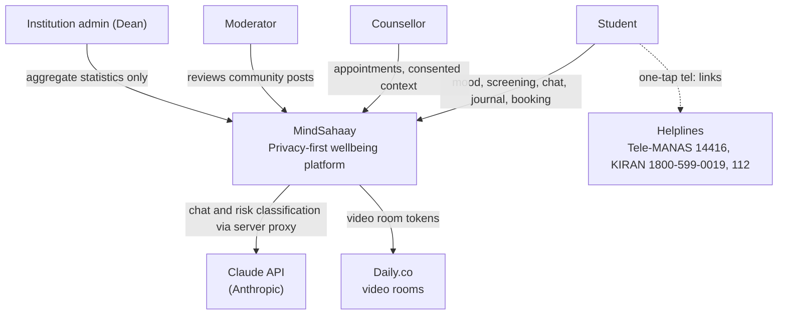
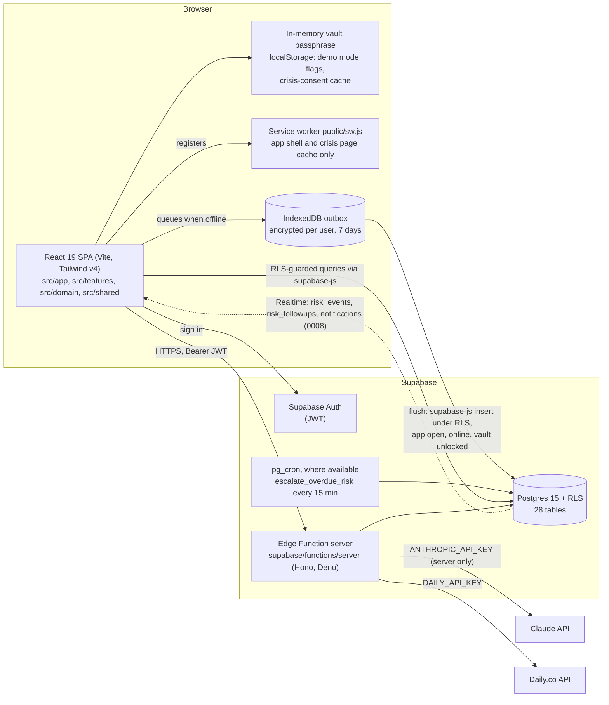
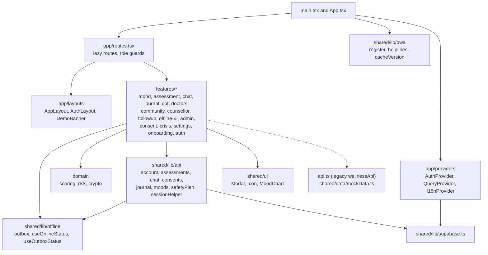
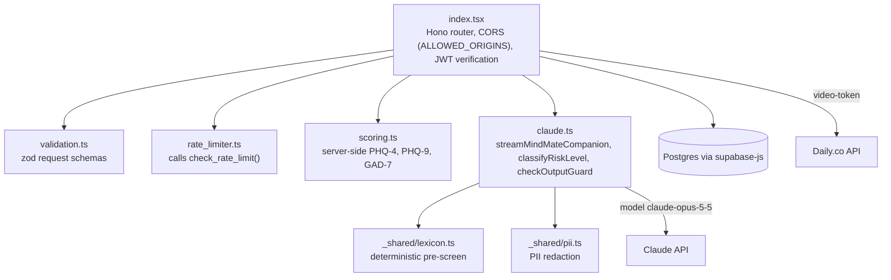
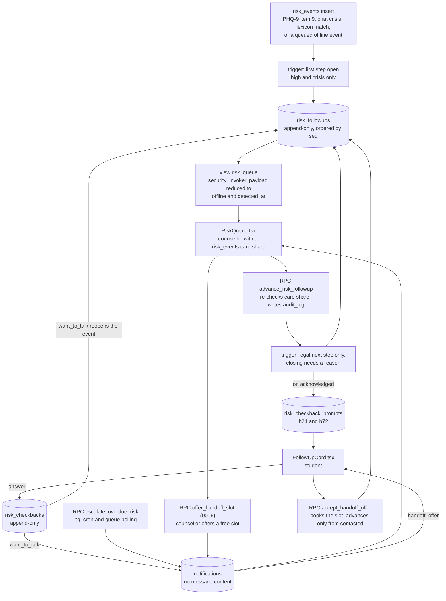
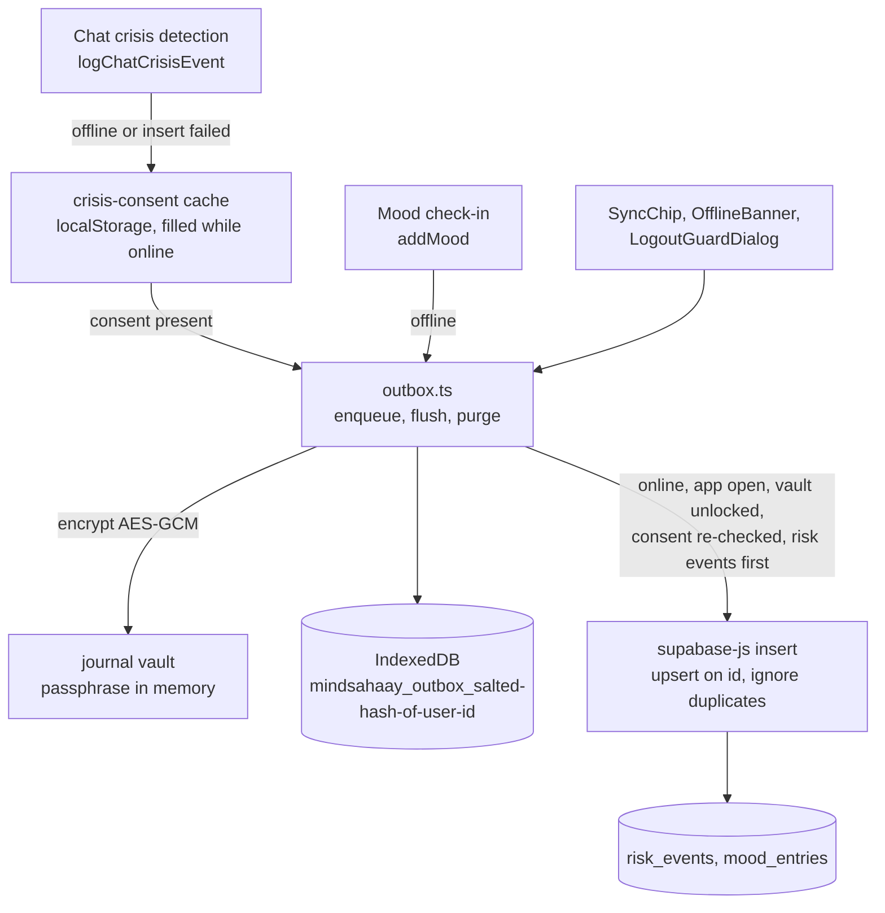

# 03 Architecture (C4 levels 1 to 3)

This document describes the system **as built in the repository** on 2026-11-20 (updated after the Crisis Follow-Through Loop and Lifeline Offline were added; first written 2026-11-19), with the parts that are not built marked. Earlier versions described only the target. Status of each requirement is in 02-srs.md section 6.

None of the Mermaid diagrams below has been rendered by a tool (mermaid-cli is not installed). They were checked by reading only.

## 1. Level 1: System context

The university administration is deliberately not a data recipient. The "Email / notification service" in the earlier diagram is removed: notifications are rows in the `notifications` table and no email provider is integrated.

## 2. Level 2: Containers

Added on 2026-11-20 (docs/25 and 26): a hand-written service worker and an IndexedDB outbox. The service worker caches only the static app shell, the `/login`, `/crisis`, `/chat` and `/dashboard` chunks and an offline page; it never intercepts Supabase, `/functions/`, `/rest/`, `/auth/`, `/realtime/`, `/storage/`, requests with an `Authorization` header or non-GET requests. The outbox holds only two kinds of item, a mood entry and a content-free risk event. It does not go through the Edge Function: a flush inserts through supabase-js, so RLS applies exactly as for an online write. A Background Sync tag is registered but `sw.js` has no `sync` handler, so nothing drains the outbox while the app is closed (L39). The journal ciphertext is still stored in Postgres, not IndexedDB. `supabase/functions/server/kv_store.tsx` is a leftover from the prototype. The `pg_cron` job is created only where the extension exists (not verified, L46).

Two ordering rules found by running the system: account erasure deletes the server account first and only then wipes local data and discards the outbox (`Settings.tsx`), and each Realtime channel gets a unique topic so that re-subscribing does not fail. Offline mood check-ins use the TanStack Query `networkMode: "always"` setting, because the default pauses mutations while offline and nothing reached the outbox.

## 3. Level 3: Components

### 3.1 Browser SPA

Module notes:

| Module | Contents |
|---|---|
| `src/domain/scoring` | `phq4.ts`, `phq9.ts`, `gad7.ts`. Pure functions, include the educational disclaimers and the PHQ-9 item 9 flag. |
| `src/domain/risk` | `lexicon.ts` (v2 multilingual deterministic risk detector), `riskRouting.ts` (action matrix and helpline directory). |
| `src/domain/crypto` | `journalCrypto.ts`: AES-256-GCM, PBKDF2-SHA-256 with 600,000 iterations, recovery code generator. |
| `src/shared/lib/api` | Typed client functions and TanStack Query hooks. Identity always comes from the session (`sessionHelper.ts`). |
| `src/features/journal` | `vault.ts` (passphrase held in memory, check blob and recovery blob in auth metadata), `VaultGate.tsx`, `Journal.tsx`. |
| `src/features/crisis`, `chat/CrisisCard.tsx`, `modals/SosModal.tsx` | Crisis surfaces. `CrisisPage.tsx` also shows the helplines' last-verified date. |
| `src/features/counsellor` | `api.ts` (reads the `risk_queue` view, wraps the RPCs `advance_risk_followup` and `escalate_overdue_risk`), `RiskQueue.tsx` (five-step queue, overdue badge, not-monitored-24/7 banner). |
| `src/features/followup` | `FollowUpCard.tsx` on the Dashboard: student status, 24 h and 72 h check-backs, helplines. Renders nothing when the student has no follow-up. |
| `src/shared/lib/offline` | `outbox.ts` (encrypted per-user IndexedDB queue, flush, 7-day purge), `useOnlineStatus.ts`, `useOutboxStatus.ts`, `registerBackgroundSync.ts`, `types.ts` (the contract). `initOutbox(userId)` is called from `src/app/layouts/AppLayout.tsx`. |
| `src/shared/lib/pwa` | `register.ts` (production only, never in demo builds), `helplines.ts` (numbers and `HELPLINES_LAST_VERIFIED`), `cacheVersion.ts` (hash that names the cache). |
| `src/features/offline-ui` | `SyncChip`, `OfflineBanner`, `LogoutGuardDialog`, `UpdateToast`; mounted in `AppLayout.tsx` below the header so the SOS button is untouched. |
| `src/features/auth/demoMode.ts` | Demo mode: five canned users (student, counsellor, moderator, institution_admin, super_admin). |
| `src/features/dashboard/*Portal.tsx` | **Static sample pages** shown at `/counsellor`, `/moderator`, `/admin` in demo mode. For a real session, `src/app/routes.tsx` mounts the API-backed `features/counsellor` and `features/admin` dashboards on `/counsellor` and `/admin`, while `/moderator` still renders `ModeratorPortal`. Not checked with live data (status as read from `routes.tsx` on 2026-11-20). |
| `src/api.ts`, `src/shared/data/mockData.ts` | Legacy prototype client and mock data, still imported by `Dashboard.tsx`, `PrivacyModal.tsx` and `CampusStories.tsx`. |

### 3.2 Edge Function (`supabase/functions/server`)

Route list (from `supabase/openapi.yaml`): `/health`, `/assessments`, `/chat/stream`, `/me/export`, `/me` (DELETE), `/moods`, `/dashboard`, `/appointments`, `/appointments/{id}/video-token`, `/moderation/classify`, `/institutions/{id}/analytics`, `/journals`, `/journals/{id}`, `/thought-records`, `/thought-records/{id}`, `/circles`, `/circles/{id}/posts`, `/safety-plan`.

TODO: the model name `claude-opus-5-5` is taken from the source code. Confirm it is a valid model identifier for your Anthropic account before deployment.

### 3.3 Crisis Follow-Through Loop (database and two screens)

Full description, roles and honest limits: 24-crisis-followup.md. Migrations: `supabase/migrations/0005_crisis_followup.sql`, `0006_handoff_and_optout.sql` (warm handoff offers, server-side check-back opt-out), `0007_security_fixes.sql` (fixes for the independent review: per-cycle notification idempotency, alias helper, escalation RPC permissions) and `0008_realtime_publication.sql` (publishes `risk_events`, `risk_followups` and `notifications` to Supabase Realtime so the counsellor queue updates live; RLS still filters the streamed rows). The single risk event for a PHQ-9 item 9 is created by a database trigger; the edge function does not insert it (a duplicate was found by running the system and removed).

The student has no write path to `risk_followups`, `risk_checkback_prompts` or the event itself. The only student write is one `risk_checkbacks` row per prompt. The old policy that let a student update their own `risk_events` row was dropped (06-threat-model.md, TH-21).

### 3.4 Offline layer

Full description: 25-offline-pwa.md (outbox) and 26-pwa-shell.md (service worker).

If the vault is locked, `enqueue` throws and a flush leaves the items untouched (L39). The server sets `created_at`; the device time travels only inside `payload.detected_at`.

## 4. Key decisions

| Decision | Rationale | Trade-off |
|---|---|---|
| Server-side proxy for Claude | Keeps the API key off the client (FR-AI-04) | Extra hop for TTFT |
| Crisis lexicon in `src/domain/risk` and a generated copy in `supabase/functions/_shared/lexicon.generated.ts` | Works without the server; server cannot be bypassed | The server copy is generated by `scripts/sync-lexicon.mjs` (hash-checked, staleness test) and agrees with the client on all 600 dataset rows. It must be regenerated after each lexicon edit |
| Postgres with RLS instead of KV | Per-user access enforced in the database | Executed on a local Supabase (146 pgTAP tests pass in files 01 to 14); hosted project not tried |
| Follow-up loop as an append-only table with a trigger-enforced order, advanced only through a `SECURITY DEFINER` RPC | The order and the audit trail cannot be skipped by a client, and the student has no write path to the event | Business rules live in SQL; changing a timing means a migration. Thresholds (4 h, 12 h, 2 h, 24 h, 72 h) have had no clinical review |
| Overdue check runs from `pg_cron` and also when a counsellor opens the queue | Still runs where `pg_cron` is missing | Without cron it runs only while someone has the queue open (L46) |
| Offline queue encrypted with the journal vault key, flushed through supabase-js under RLS | No plaintext crisis metadata at rest on a shared device; no new server endpoint | Needs an unlocked vault (L39); a student without a vault cannot queue |
| Service worker never handles Supabase or authenticated requests | Nothing personal can be cached | Only the static shell works offline; other routes need a connection |
| Cache version is a hash that includes the helpline file | A changed number replaces every cached copy at the next release | A device that stays offline keeps the old copy |
| Client-side journal encryption | Server cannot read journals (DPDP principle 2) | Lost passphrase and recovery code means lost data |
| Crisis-flagged turns return safe output | Predictable output (FR-CRISIS-06) | Less personal replies |
| Demo mode in the SPA | Lets examiners run the app without a backend | Demo data is static; not evidence of backend behaviour |

## 5. Differences from the original prototype

| Prototype | Now |
|---|---|
| Anon key as bearer, `studentId` in URL | Per-user JWT, identity from token |
| KV store keys `student:`, `moods:` ... | 24-table relational schema (04-erd.md) |
| Fixed canned replies as local fallback | Claude through the proxy; degraded mode in `Chat.tsx` |
| Journals in localStorage | Client-encrypted ciphertext in `journal_entries` |
| Single `App.tsx` | Feature folders with lazy routes |

## 6. Known gaps against the target

- Offline crisis content depends on a service worker that has been tested in desktop Chromium only, after one online visit (L18). Background Sync is registered but not handled (L39).
- The follow-up loop is in-app only. Nothing is monitored around the clock and no counselling service has agreed to receive alerts (L29).
- The check-back opt-out is stored on the server and the warm handoff is built (migration 0006, pgTAP file 11, L43). Both are young: unit, pgTAP and UI tests only, no real-browser end-to-end check of the handoff, no clinical review, no real-device check.
- An independent review (28-new-features-security-review.md) found a Critical defect: an event reopened by "I want to talk" was not escalated again when overdue (G6-SEC-01). It is fixed in migration 0007 (idempotency is now per follow-up cycle) with failing-first pgTAP tests, so the "overdue escalation" box in section 3.3 holds for reopened events. Nobody is alerted while a device is offline, and `pg_cron` is not verified (L46, L50).
- Role portals at `/counsellor`, `/moderator`, `/admin` are only partly backed by data: in demo mode they show static sample pages, and none was checked with live data (see 3.1 and 19-known-limitations.md L14).
- The edge function has 188 Vitest tests and was verified on the real Supabase edge runtime with real JWTs (local stack). The Claude chat route and Daily.co video tokens were not verified (they need API keys), and nothing is deployed to a hosted project.
- Server crisis classifier (LLM layer) has no measured accuracy (11-ai-evaluation-plan.md).
