# 04 Entity Relationship Diagram (as implemented in the migrations)

This file describes the schema written in `supabase/migrations/0001_core.sql` to `0008_realtime_publication.sql`: **28 tables**, all with row level security (RLS) enabled. Migration 0005 (Crisis Follow-Through Loop, added 2026-11-20) adds four tables, one enum, one view and two RPCs; see sections 1 to 5 and 24-crisis-followup.md. Migration 0006 (`0006_handoff_and_optout.sql`, warm handoff and server-side check-back opt-out) adds **no table**: it adds one column, `profiles.checkback_opt_out boolean NOT NULL DEFAULT false`, and four RPCs (section 3). Handoff offers are `notifications` rows of type `handoff_offer` with the slot, counsellor and status in `metadata` (no message text). Migration 0007 (`0007_security_fixes.sql`, fixes for the independent review) and migration 0008 (`0008_realtime_publication.sql`) add **no table**: 0007 replaces functions, policies and triggers (section 3), and 0008 adds `risk_events`, `risk_followups` and `notifications` to the `supabase_realtime` publication so the counsellor queue updates live (Realtime still applies each subscriber's RLS). Table and column names below are copied from the SQL.

**Status (2026-11-20).** The SQL has been **executed on a local Supabase stack** (CLI 3.2.0, Docker): migrations 0001 to 0008 and `seed.sql` apply, 28 tables exist with RLS enabled on all of them, and the pgTAP files `supabase/tests/01` to `14` pass (14 files, 146 tests, measured 2026-11-20). Files 12 and 13 are the failing-first regression tests for the independent review (docs/28) and now pass after migration 0007; file 14 checks the realtime publication. Running the SQL found defects that reading missed (21-sql-audit.md, findings 22 to 28 and the later ones), so this document may still differ from the migrations in places. It has **not** been run on a hosted Supabase project.

| Migration | Tables | Count |
|---|---|---|
| 0001_core.sql | institutions, profiles, consents, mood_entries, assessments, journal_entries, safety_plans, risk_events, counsellors, availability_slots, appointments, session_notes, care_shares, notifications, audit_log | 15 |
| 0002_triggers.sql | none (triggers, three aggregate views, one summary function) | 0 |
| 0003_rate_limit.sql | rate_limits | 1 |
| 0004_community_booking.sql | circles, circle_members, posts, comments, reports, thought_records, chat_sessions, chat_messages | 8 |
| 0005_crisis_followup.sql | institution_backup_counsellors, risk_followups, risk_checkback_prompts, risk_checkbacks (plus enum `followup_step`, view `risk_queue`, RPCs `advance_risk_followup` and `escalate_overdue_risk`) | 4 |
| 0006_handoff_and_optout.sql | none (column `profiles.checkback_opt_out`, four RPCs) | 0 |
| 0007_security_fixes.sql | none (function, policy and trigger fixes after the independent review) | 0 |
| 0008_realtime_publication.sql | none (adds three tables to the `supabase_realtime` publication) | 0 |
| **Total** | | **28** |

(`supabase/README.md` says 21 tables. That count is out of date; the migrations define 28.)

## 1. Diagram

```mermaid
erDiagram
  institutions ||--o{ profiles : "has members"
  institutions ||--o{ counsellors : employs
  institutions ||--o{ circles : hosts
  profiles ||--o{ consents : grants
  profiles ||--o{ mood_entries : logs
  profiles ||--o{ assessments : completes
  profiles ||--o{ journal_entries : writes
  profiles ||--o| safety_plans : owns
  profiles ||--o{ risk_events : triggers
  profiles ||--o| counsellors : "may be"
  profiles ||--o{ appointments : books
  profiles ||--o{ care_shares : grants
  profiles ||--o{ notifications : receives
  profiles ||--o{ audit_log : acts_in
  profiles ||--o{ thought_records : writes
  profiles ||--o{ chat_sessions : opens
  profiles ||--o{ circle_members : joins
  profiles ||--o{ posts : authors
  profiles ||--o{ comments : authors
  profiles ||--o{ reports : files
  profiles ||--o{ risk_followups : "acts in"
  profiles ||--o{ risk_checkbacks : answers
  profiles ||--o{ risk_checkback_prompts : "is asked"
  risk_events ||--o{ risk_followups : "has steps"
  risk_events ||--o{ risk_checkback_prompts : "has prompts"
  risk_events ||--o{ risk_checkbacks : "has answers"
  risk_checkback_prompts ||--o| risk_checkbacks : "answered once"
  institutions ||--o| institution_backup_counsellors : "has one backup"
  counsellors ||--o{ institution_backup_counsellors : "is backup"
  counsellors ||--o{ availability_slots : offers
  counsellors ||--o{ appointments : receives
  counsellors ||--o{ care_shares : "is granted"
  counsellors ||--o{ session_notes : writes
  availability_slots ||--o| appointments : reserved_by
  appointments ||--o{ session_notes : has
  circles ||--o{ circle_members : has
  circles ||--o{ posts : contains
  posts ||--o{ comments : has
  comments ||--o{ comments : "replies to"
  chat_sessions ||--o{ chat_messages : contains

  institutions {
    uuid id PK
    text name
    text code UK
    text domain UK
    text city
    text state
    text helpline_contact
    timestamptz created_at
  }
  profiles {
    uuid id PK "same as auth.users.id"
    user_role role "student, counsellor, moderator, institution_admin, super_admin"
    text alias
    text locale
    uuid institution_id FK
    text avatar_seed
    boolean checkback_opt_out "0006, default false"
    timestamptz created_at
    timestamptz updated_at
  }
  consents {
    uuid id PK
    uuid student_id FK
    consent_purpose purpose
    boolean consented
    text policy_version
    text ip_hash
    text user_agent_hash
    timestamptz granted_at
    timestamptz revoked_at
  }
  mood_entries {
    uuid id PK
    uuid student_id FK
    text mood
    integer score "1 to 10"
    text_array tags
    text notes
    timestamptz created_at
  }
  assessments {
    uuid id PK
    uuid student_id FK
    assessment_instrument instrument "phq9, gad7, phq4"
    integer_array answers
    integer total
    text severity
    boolean item9_flag
    jsonb metadata
    timestamptz completed_at
    timestamptz created_at
  }
  journal_entries {
    uuid id PK
    uuid student_id FK
    text ciphertext
    text iv
    text salt
    timestamptz created_at
    timestamptz updated_at
  }
  safety_plans {
    uuid id PK
    uuid student_id FK "unique"
    text_array warning_signs
    text_array coping_strategies
    jsonb emergency_contacts
    text_array safe_environments
    text_array reasons_to_live
    jsonb professional_support
    timestamptz updated_at
  }
  risk_events {
    uuid id PK
    uuid student_id FK
    text event_type
    risk_severity severity_level "low, medium, high, crisis"
    risk_trigger trigger_source "phq9_item9, chat_crisis, lexicon_match, manual, assessment_escalation"
    text action_taken
    jsonb payload
    boolean resolved
    timestamptz resolved_at
    timestamptz created_at
  }
  risk_followups {
    uuid id PK
    bigint seq "generated identity, orders steps"
    uuid risk_event_id FK
    followup_step step "open, acknowledged, contacted, handed_off, closed"
    uuid actor_id FK "counsellor, or the student for a reopen"
    text closure_reason "only when closed, fixed list of five"
    text note "500 characters at most"
    timestamptz created_at
  }
  risk_checkback_prompts {
    uuid id PK
    uuid risk_event_id FK
    uuid student_id FK
    text kind "h24 or h72, unique with risk_event_id"
    timestamptz due_at
    timestamptz created_at
  }
  risk_checkbacks {
    uuid id PK
    uuid risk_event_id FK
    uuid prompt_id FK "unique"
    uuid student_id FK
    text answer "okay or want_to_talk"
    timestamptz answered_at
  }
  institution_backup_counsellors {
    uuid institution_id PK "one backup per institution"
    uuid counsellor_id FK
  }
  counsellors {
    uuid id PK "same as profiles.id"
    text license_number
    text_array specializations
    text bio
    boolean verified
    uuid institution_id FK
    timestamptz created_at
  }
  availability_slots {
    uuid id PK
    uuid counsellor_id FK
    timestamptz start_time
    timestamptz end_time
    boolean is_booked
    timestamptz created_at
  }
  appointments {
    uuid id PK
    uuid student_id FK
    uuid counsellor_id FK
    uuid slot_id FK
    timestamptz scheduled_at
    appointment_status status "scheduled, confirmed, completed, cancelled"
    text meeting_url
    text notes
    timestamptz created_at
  }
  session_notes {
    uuid id PK
    uuid appointment_id FK
    uuid counsellor_id FK
    uuid student_id FK
    text ciphertext
    text iv
    timestamptz created_at
    timestamptz updated_at
  }
  care_shares {
    uuid id PK
    uuid student_id FK
    uuid counsellor_id FK
    boolean active
    text_array scope "default assessments, moods"
    timestamptz granted_at
    timestamptz expires_at
    timestamptz revoked_at
  }
  notifications {
    uuid id PK
    uuid user_id FK
    text title
    text body
    text type
    boolean read
    jsonb metadata
    timestamptz created_at
  }
  audit_log {
    uuid id PK
    uuid actor_id FK
    text action
    text resource_type
    text resource_id
    jsonb details
    text ip_hash
    timestamptz created_at
  }
  rate_limits {
    text key PK
    float tokens
    timestamptz last_refill
    integer max_tokens
    float refill_rate
    timestamptz created_at
    timestamptz updated_at
  }
  circles {
    uuid id PK
    text name
    text slug UK
    text description
    text category
    uuid institution_id FK "null means inter-college"
    boolean is_private
    uuid created_by FK
    timestamptz created_at
    timestamptz updated_at
  }
  circle_members {
    uuid id PK
    uuid circle_id FK
    uuid user_id FK
    text role "member, moderator, admin"
    timestamptz joined_at
  }
  posts {
    uuid id PK
    uuid circle_id FK
    uuid author_id FK
    text title
    text content
    boolean is_anonymous
    moderation_status moderation_status "pending, approved, flagged, rejected"
    jsonb ai_moderation
    integer likes_count
    timestamptz created_at
    timestamptz updated_at
  }
  comments {
    uuid id PK
    uuid post_id FK
    uuid author_id FK
    text content
    boolean is_anonymous
    moderation_status moderation_status
    jsonb ai_moderation
    uuid parent_comment_id FK
    timestamptz created_at
    timestamptz updated_at
  }
  reports {
    uuid id PK
    uuid reporter_id FK
    text resource_type "post, comment, chat_message, profile"
    text resource_id
    text reason
    text details
    moderation_status moderation_status
    jsonb ai_moderation
    uuid reviewed_by FK
    timestamptz reviewed_at
    text action_taken
    timestamptz created_at
  }
  thought_records {
    uuid id PK
    uuid student_id FK
    text ciphertext
    text iv
    text salt
    timestamptz created_at
    timestamptz updated_at
  }
  chat_sessions {
    uuid id PK
    uuid user_id FK
    text title
    risk_severity risk_level
    integer retention_ttl_days "default 30"
    timestamptz created_at
    timestamptz updated_at
  }
  chat_messages {
    uuid id PK
    uuid session_id FK
    text sender_role "user, assistant, counsellor, system"
    text encrypted_content
    text iv
    risk_severity risk_level
    timestamptz retention_expires_at "default now plus 30 days"
    timestamptz created_at
  }
```

`reports.resource_id` is a free text reference to a post, comment, chat message or profile, so it has no foreign key and no relationship line. `circle_members` has a unique constraint on `(circle_id, user_id)`.

## 2. Enumerated types

| Type | Values |
|---|---|
| user_role | student, counsellor, moderator, institution_admin, super_admin |
| consent_purpose | data_processing, crisis_intervention, analytics, counsellor_sharing, peer_support, research |
| assessment_instrument | phq9, gad7, phq4 |
| risk_severity | low, medium, high, crisis |
| risk_trigger | phq9_item9, chat_crisis, lexicon_match, manual, assessment_escalation |
| appointment_status | scheduled, confirmed, completed, cancelled |
| followup_step | open, acknowledged, contacted, handed_off, closed |
| moderation_status | pending, approved, flagged, rejected |

## 3. Functions, triggers and views

| Object | Migration | Purpose |
|---|---|---|
| `has_active_care_share()`, `is_super_admin()`, `is_institution_admin()` | 0001 | RLS helper functions |
| `handle_new_user()` + trigger `on_auth_user_created` | 0002 | Creates an alias profile on signup |
| `enforce_consents_append_only()` + `trg_prevent_consents_tampering` | 0002 | Blocks UPDATE and DELETE on consents (see note below) |
| `enforce_audit_log_append_only()` + `trg_prevent_audit_log_tampering` | 0002 | Blocks UPDATE and DELETE on audit_log |
| `log_audit_event()`, `audit_care_shares_trigger()` + `trg_audit_care_shares` | 0002 | Writes audit rows |
| `handle_assessment_crisis_trigger()` + `trg_assessment_crisis` | 0002 | Creates a risk_event when `item9_flag` is true |
| Views `institution_assessment_aggregates`, `institution_mood_aggregates`, `institution_risk_aggregates` | 0002 | Aggregates with `HAVING count(*) >= 10` (k-anonymity, k = 10) |
| `get_institution_wellbeing_summary()` | 0002 | Summary for institution admins |
| `check_rate_limit()`, `cleanup_stale_rate_limits()` | 0003 | Token bucket limiter |
| `is_moderator()` | 0004 | RLS helper |
| `book_appointment_atomic()` | 0004 | Row-locked booking |
| `purge_expired_chat_messages()` | 0004 | Retention purge (0004 attempts `cron.schedule` and skips with a NOTICE if pg_cron is unavailable) |
| `enforce_risk_event_server_timestamp()` + `trg_enforce_risk_event_server_timestamp` | 0005 | Forces `risk_events.created_at = now()` on insert and keeps it on update unless the caller is the trusted backend, so an offline event cannot be back-dated |
| `handle_new_risk_event_followup()` + `trg_create_initial_risk_followup` | 0005 | Writes the first `open` step for `high` and `crisis` events (not for `low` and `medium`) |
| `validate_risk_followup_transition()` + `trg_validate_risk_followup_transition` | 0005 | Allows only open to acknowledged to contacted to handed_off to closed, one step at a time; requires a closure reason from a fixed list on `closed` and none otherwise; refuses a step on a closed event; allows `open` again only while the session setting `app.checkback_reopen` is set by the check-back trigger |
| `enforce_risk_followups_append_only()`, `enforce_risk_checkbacks_append_only()` + triggers | 0005 | Block UPDATE and direct DELETE; cascade delete (erasure) is allowed when the trigger depth is above 1 |
| `handle_risk_followup_after_insert()` + `trg_handle_risk_followup_after_insert` | 0005 | On `closed`: sets `risk_events.resolved` and `resolved_at`. On `acknowledged`: creates the `h24` and `h72` check-back prompts |
| `validate_risk_checkback_insert()`, `handle_risk_checkback_after_insert()` + triggers | 0005 | The prompt and the event must belong to the inserting student; on `want_to_talk` reopens the event (never closes or lowers it) and notifies counsellors with a `risk_events` care share |
| `advance_risk_followup(event, step, closure_reason, note)` | 0005 | RPC (SECURITY DEFINER, fixed search_path). Caller must be a verified counsellor with a current `risk_events` care share, or a super admin. Refuses `open`. Writes `audit_log`. |
| `escalate_overdue_risk()` | 0005 | RPC (SECURITY DEFINER). For events still at `open` after 4 h (crisis) or 12 h (high) notifies counsellors with a share; after 2 h more notifies the institution backup counsellor. One notification per (event, level, follow-up cycle). **Fixed in 0007 (docs/28, G6-SEC-01, Critical):** the "already notified" test used to look at any past notification, so an event reopened by "I want to talk" was never escalated a second time; idempotency is now per follow-up cycle, enforced with a unique index and an advisory lock (G6-SEC-07), and the caller is restricted. pgTAP 12 and 13 cover it. Scheduled every 15 minutes if `pg_cron` exists. |
| `get_student_alias_for_care(uuid)` | 0005 | Helper used by the queue view so a counsellor can show a student alias without a policy loop. **Fixed in 0007 (docs/28, G6-SEC-02):** it now checks the caller (the student, a verified counsellor with an active care share, a super admin or the trusted backend); before that, any signed-in user who knew a student UUID could read the alias. |
| `is_student_opted_out(uuid)`, `set_checkback_opt_out(boolean)` | 0006 | The first reads `profiles.checkback_opt_out`; the trigger that creates the `h24` and `h72` prompts skips them when it is true. The second is the RPC a student uses to set their own flag (counsellors are refused). |
| `offer_handoff_slot(event, slot, note)` | 0006 | RPC. Verified counsellor with a current `risk_events` care share offers one of their own future, unbooked slots; writes a `handoff_offer` notification for the student and an audit row. |
| `accept_handoff_offer(notification)`, `decline_handoff_offer(notification)` | 0006 | RPCs for the offered student only. Accept books the slot through `book_appointment_atomic` (once; repeating returns the same appointment), moves the follow-up to `handed_off` only if it is at `contacted`, and refuses offers older than 24 h. Decline marks the offer declined. |
| View `risk_queue` (`security_invoker = true`) | 0005 | One row per risk event with alias, severity, current step and time, `is_overdue`, `overdue_threshold_hours`, and a payload reduced to `offline` and `detected_at`. RLS of the caller applies. |
| `has_active_care_share(student, counsellor, scope)`, notification triggers, handoff RPC hardening | 0007 | A revoked care share (
evoked_at set) no longer counts as active. Inserting 
otifications directly is locked and notification metadata is immutable (no spoofed or edited alerts). The handoff RPCs refuse cross-user acceptance, slot hijack and replay. Every SECURITY DEFINER function has a fixed search_path and non execute rights are revoked. |
| Publication supabase_realtime | 0008 | Adds 
isk_events, 
isk_followups and 
otifications. Before 0008 the publication was empty, so the live queue never received an event. RLS still filters the rows each subscriber receives. |

Note on append-only consents: an append-only trigger means the "erase everything" request (DPDP erasure) must delete through the profile cascade. Whether the trigger permits that cascade delete is covered by pgTAP `04_triggers_and_append_only`, which passes on a local Supabase (not run on a hosted project). The two new append-only tables (`risk_followups`, `risk_checkbacks`) use the same idea: direct updates and deletes are refused, cascade deletes are allowed.

## 4. Constraints worth knowing

- `availability_slots` has `no_overlapping_slots`: a GiST exclusion constraint on `(counsellor_id, tstzrange(start_time, end_time))`. This needs the `btree_gist` extension. It prevents overlapping slots for one counsellor.
- Double booking is prevented by `book_appointment_atomic()` taking a `FOR UPDATE` lock on the slot and setting `is_booked`. `appointments.slot_id` has no UNIQUE index (the original design in this file proposed one; the implementation chose the lock instead).
- `care_shares` has `UNIQUE (student_id, counsellor_id)`, so one share row per pair; revoke sets `revoked_at` and `active`.
- `profiles`, `consents`, `mood_entries`, `assessments`, `journal_entries`, `safety_plans`, `risk_events`, `thought_records`, `chat_sessions` all use `ON DELETE CASCADE` from the profile, which is the basis of erasure.
- `posts.moderation_status` defaults to `approved`, not `pending`. FR-COMM-02 ("held for moderation") therefore depends on the client or edge function setting `pending` explicitly. A grep of `supabase/functions/server/index.tsx` found no such assignment, so this is TODO.
- `risk_followups` is ordered by `seq` (a generated identity), not by `created_at`, so the order does not depend on timestamps. The current step is "the row with the highest `seq`". `risk_checkback_prompts` has `UNIQUE (risk_event_id, kind)` and `risk_checkbacks.prompt_id` is `UNIQUE`, so a prompt is asked once and answered once. `risk_events.created_at` is set by the server (trigger), never by the client.
- `institution_backup_counsellors` has one counsellor per institution (primary key `institution_id`) and no screen to edit it; it is filled from seed data or by an institution admin through SQL (L45).
- Likes are only a `posts.likes_count` integer. There is no likes table, so "who liked" is not stored.

## 5. RLS summary (from `CREATE POLICY` statements)

| Table group | Student (owner) | Counsellor | Moderator | Institution admin or super admin |
|---|---|---|---|---|
| profiles, consents (insert and read), mood_entries, journal_entries, thought_records, chat_sessions, chat_messages, notifications | own rows only | none | none | none |
| assessments, safety_plans | own rows | read via active care share (`has_active_care_share`) | none | none |
| risk_events | own rows: insert and read. **No UPDATE** since 0005 (the student branch of the update policy was dropped) | read, and update (resolution) with a current `risk_events` care share | none | super admin may update |
| risk_followups | read own events' steps; no insert (only the trusted backend, through the RPC and triggers) | read steps for students who shared `risk_events`; advance only through `advance_risk_followup` | none | super admin reads |
| risk_checkback_prompts | read own; no insert (created by trigger) | read for students with a `risk_events` share | none | super admin reads |
| risk_checkbacks | insert own answer for own prompt (once), read own | read for students with a `risk_events` share | none | super admin reads |
| institution_backup_counsellors | read (all signed-in users, `USING (true)`) | read | none | manage for own institution, or super admin |
| counsellors | read verified | manage own row | none | none |
| availability_slots | read | manage own | none | none |
| appointments | participants (student or counsellor) read, student insert, participants update | same | none | none |
| session_notes | none | counsellor manages own | none | none |
| care_shares | grant, revoke, delete own | read shares addressed to them | none | none |
| circles, posts, comments | read approved, create, edit own | as student | manage via `is_moderator()` | as moderator (role helper functions) |
| reports | file and read own | none | read and update all | none |
| audit_log | read own entries, insert | none | none | none |
| rate_limits | no access (REVOKE) | no access | no access | no access |
| aggregate views | none | none | none | read via `get_institution_wellbeing_summary()` and views, k >= 10 |

TODO: this table was assembled by reading policy names and first lines. Exact `USING` and `WITH CHECK` expressions should be re-read during security review, and pgTAP run.

## 6. Differences from the earlier target schema

| Earlier ERD in this file | Implemented |
|---|---|
| PROFILE with `role`, `age_confirmed`, `institution_code` | `profiles` has `role`, `alias`, `locale`, `institution_id`; **no age confirmation column** |
| SCREENING_RESULT | `assessments` (adds GAD-7, `item9_flag`) |
| CRISIS_EVENT with no message text | `risk_events` with `payload jsonb`. TODO verify that no message text is written into `payload` |
| STORY, STORY_LIKE, STORY_REPORT, MODERATION_ACTION | Replaced by `circles`, `circle_members`, `posts`, `comments`, `reports` (moderation fields live on the rows) |
| COUNSELLOR separate id | `counsellors.id` equals `profiles.id` |
| `CHAT_MESSAGE.content` plain text | `encrypted_content` + `iv`. The edge function code has no reference to `encrypted_content`, so who writes chat rows and with which key is TODO |
| Appointment states requested, confirmed, completed, cancelled, no_show, rescheduled | scheduled, confirmed, completed, cancelled |

## 7. Prototype KV mapping

| KV key (original prototype) | Table now |
|---|---|
| `student:<id>` | profiles |
| `moods:<id>` | mood_entries |
| `assessment:<id>` | assessments |
| `appointments:<id>` | appointments |
| `chat:<id>` | chat_sessions, chat_messages |
| localStorage journals | journal_entries (ciphertext) |
| localStorage stories | posts in circles |

