# 05 UML Models

Updated 2026-11-19 to use the module, table and function names that exist in the repository, and on 2026-11-20 with the Crisis Follow-Through Loop and Lifeline Offline (sections 8 to 10; use cases 14 to 16; the `Outbox` and `RiskQueueApi` classes). No diagram has been rendered by a tool; each was checked by reading the Mermaid syntax. Where the code differs from the original design, the text says so.

## 1. Use-case diagram

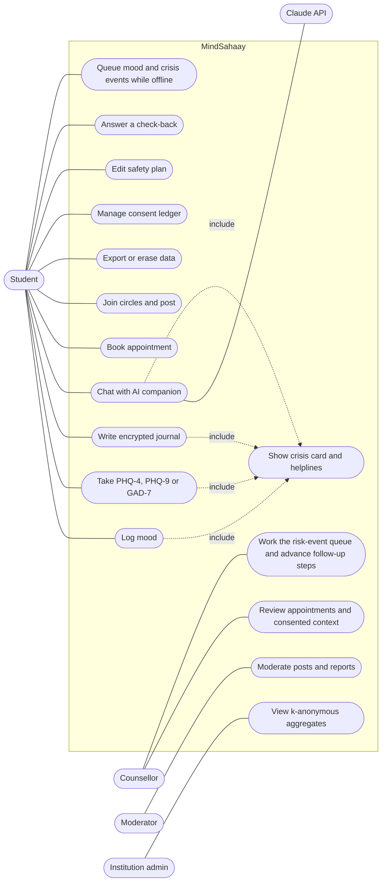

Crisis checking is an `include` of every free-text use case. The admin use case exposes aggregates only, through views with a minimum group size of 10. Implementation status of the counsellor, moderator and admin screens is in 02-srs.md (the routed pages are still static mock pages in demo mode; the risk-event queue, use case 14, is API-backed and was checked by hand with a real counsellor session on a local Supabase).

## 2. Class diagram (domain modules and services)

Names match `src/domain`, `src/shared/lib/api` and `supabase/functions/server`. Methods are the exported functions, shown as operations.

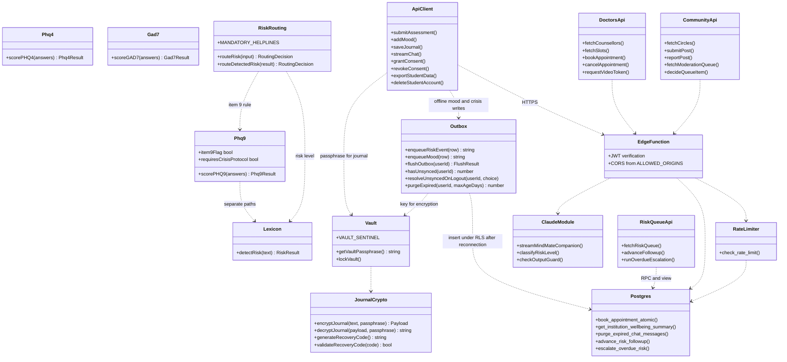

Operation names were checked against the exported names in `src/domain` (`scorePHQ9`, `scorePHQ4`, `scoreGAD7`, `detectRisk`, `routeRisk`, `routeDetectedRisk`, `encryptJournal`, `decryptJournal`, `generateRecoveryCode`, `validateRecoveryCode`). Parameter and result types in the diagram are simplified and not copied from the signatures.

The persistent entities (profiles, consents, mood_entries, assessments, journal_entries, appointments, posts and so on) are in 04-erd.md.

## 3. Sequence: chat with crisis handling

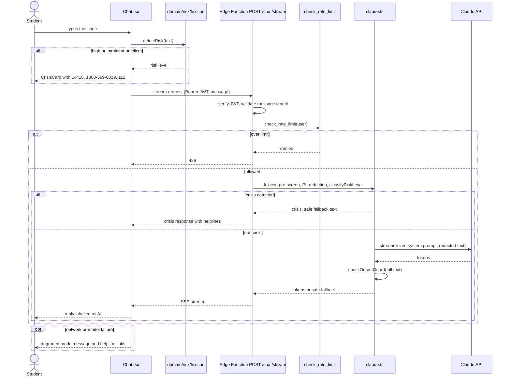

Differences from the earlier design: the output guard runs on the completed text, so a violation replaces the reply after streaming (TODO: confirm how the UI handles this); `risk_events` logging goes through `logChatCrisisEvent` in `features/chat/api.ts`.

## 4. Sequence: booking

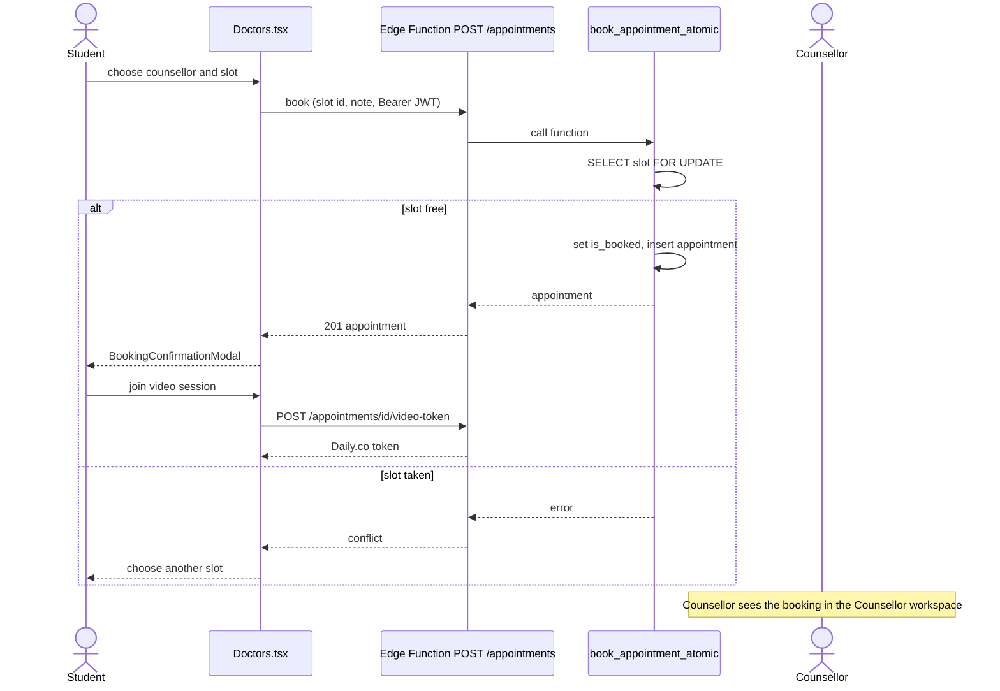

Not implemented from the original: a "requested" state and counsellor confirmation step. Appointments are created directly; the enum default is `confirmed`.

## 5. Sequence: screening (PHQ-9)

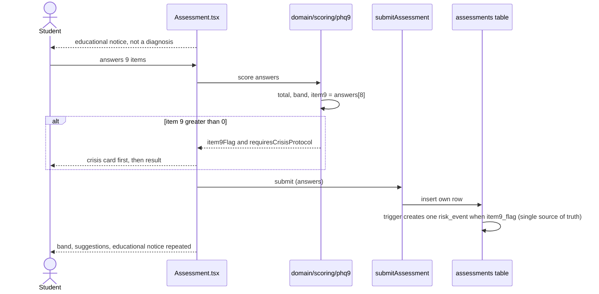

## 6. Sequence: journal vault and recovery

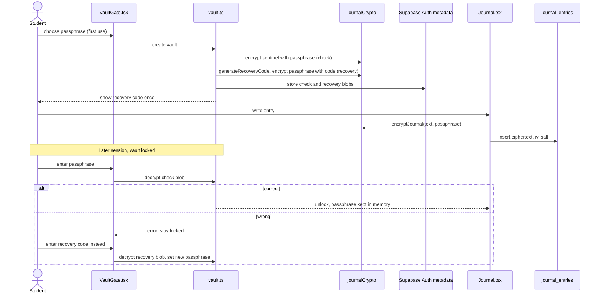

The exact first-use and reset steps in `VaultGate.tsx` were not read line by line. TODO: verify the diagram against the component before quoting it.

## 7. Appointment state machine

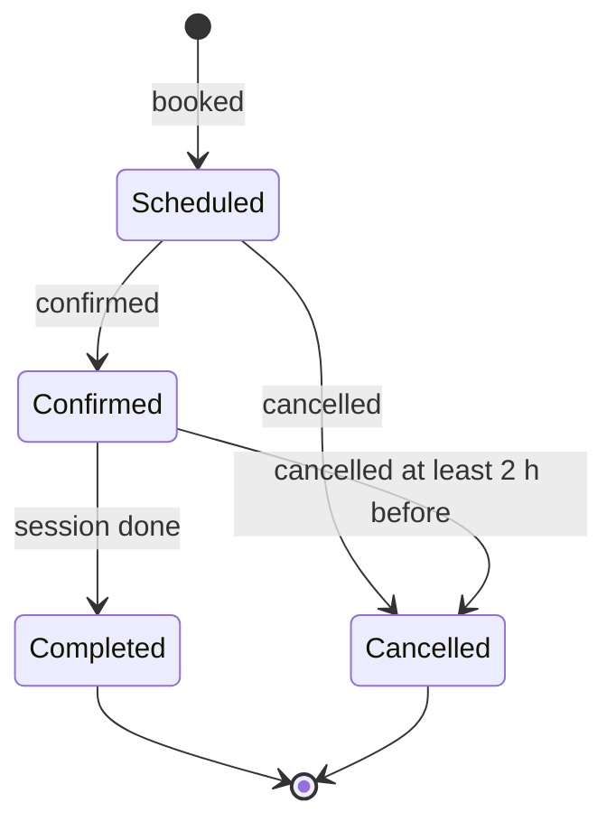

This matches the `appointment_status` enum (scheduled, confirmed, completed, cancelled). The table default is `confirmed`, so in practice rows may start in Confirmed. The earlier states Requested, Rescheduled and NoShow are not implemented. TODO: confirm with counsellors whether they are needed.

## 8. State machine: follow-up of a risk event

Source: `supabase/migrations/0005_crisis_followup.sql` (trigger `validate_risk_followup_transition`) and `0006_handoff_and_optout.sql` (the accept-handoff path). The same diagram appears in 24-crisis-followup.md. The independent review (28-new-features-security-review.md, G6-SEC-01, Critical) found that the overdue job did not escalate a reopened event a second time; migration 0007 fixed it (idempotency is per follow-up cycle) and pgTAP 12 passes.

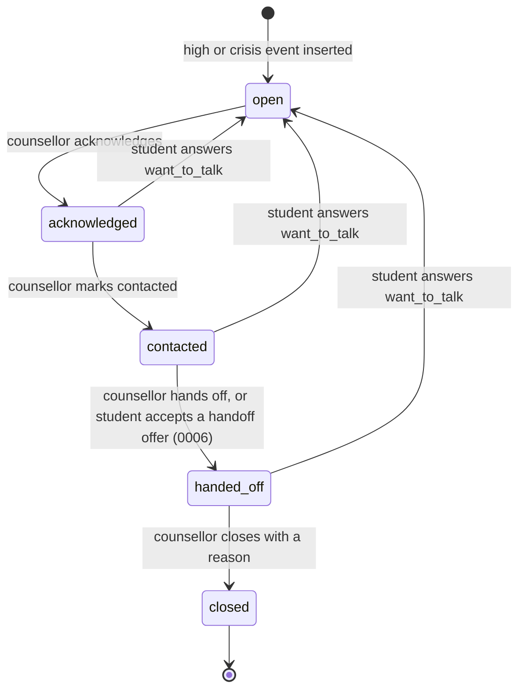

A step can only move forward by exactly one. Going back to `open` happens only through the check-back trigger. A "want to talk" answer on an event that is already `open` appends another `open` row (not drawn). A closed event cannot be reopened or advanced. A student answer can never close or lower an event.

## 9. Sequence: follow-up loop and check-back

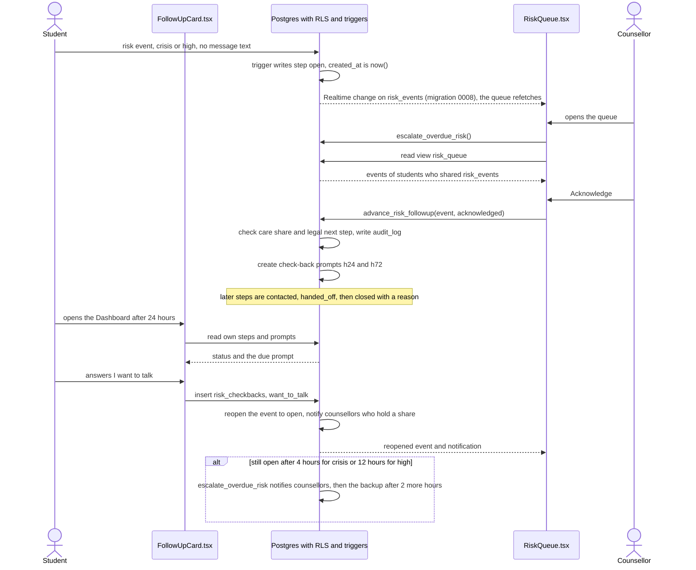

Nobody is paged. The notifications appear only when a counsellor signs in (24-crisis-followup.md section 6, L29).

## 10. Sequence: crisis event queued offline, then sent

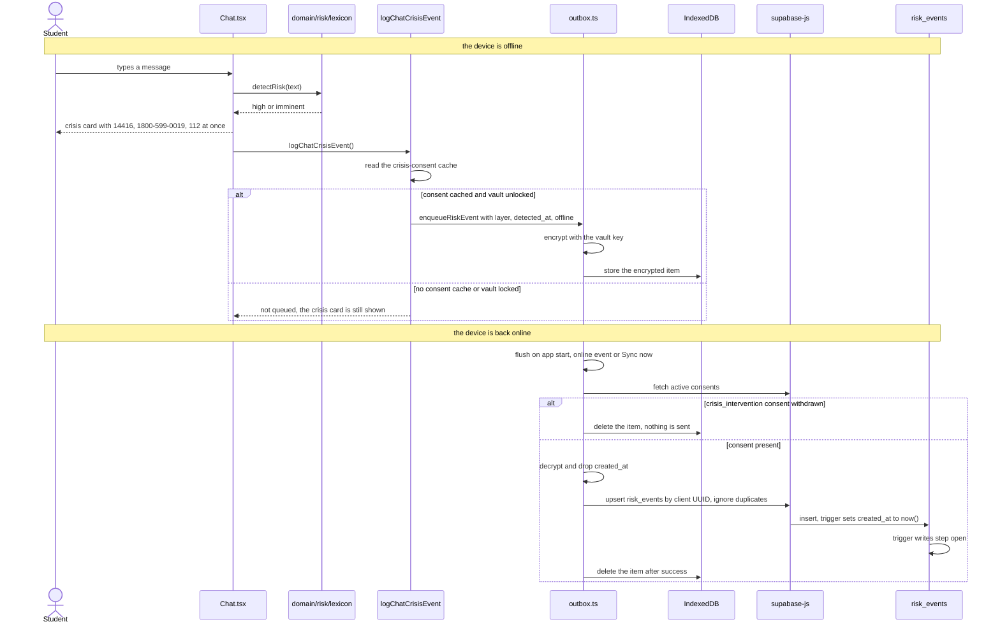

Risk events are sent before mood entries. If sending fails the item stays with exponential backoff, and it is deleted after 7 days. Nobody is alerted until this flush succeeds (L38).

## 11. Sequence: warm handoff offer (migration 0006)

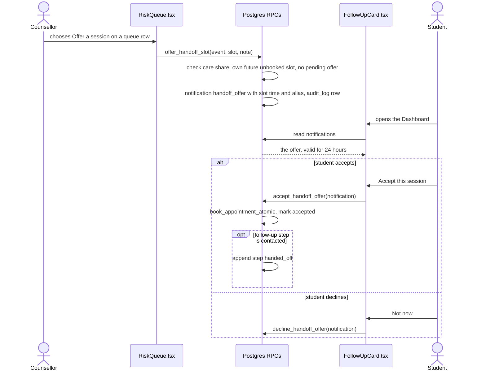

Accepting twice books once. If the follow-up is still at `open` or `acknowledged` the session is booked but the step is not forced forward. The offer is an in-app notification only: nobody phones or messages the student (L43, L29).
