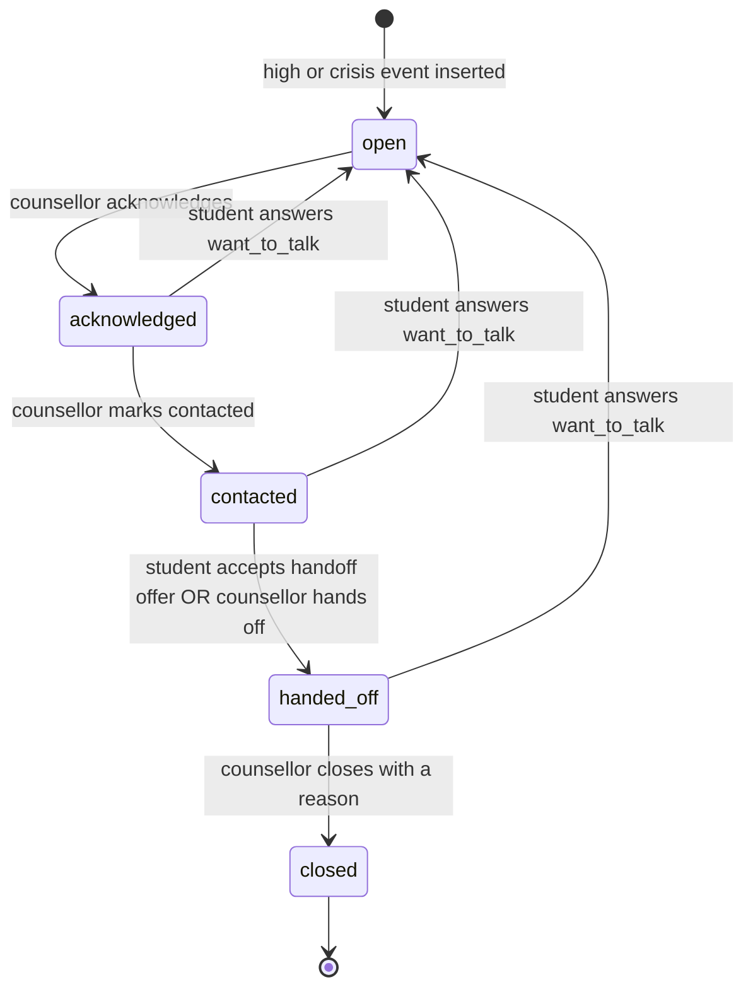

# 24. Crisis Follow-Through Loop

Status: implemented in the app and database (migrations `0005_crisis_followup.sql`, `0006_handoff_and_optout.sql`, `0007_security_fixes.sql` and `0008_realtime_publication.sql`). Tested with unit tests, pgTAP (14 files, 146 tests, all passing on a real local Postgres) and real-backend browser tests (docs/29). Reviewed independently in docs/28. Educational support software, not a clinical service.

## 1. What problem it addresses

Before this feature a high-risk event (PHQ-9 item 9 above zero, a crisis chat message, a lexicon match) produced a row in `risk_events` and a counsellor could tick "resolved". Nothing recorded who acted, what they did, or whether the student was ever asked how they were. Limitation L29 said so. The loop adds a short, ordered, auditable path from "flag raised" to "closed with a reason", a gentle way for the student to answer back, and a warm handoff mechanism where counsellors can offer consultation slots directly from the risk queue.

It does **not** make the platform a monitored crisis service. See section 6.

## 2. How the loop works

1. **Flag.** A `risk_events` row with severity `high` or `crisis` is inserted. A database trigger writes the first `open` step to `risk_followups`. For a PHQ-9 item 9 answer the database trigger `trg_assessment_crisis` is the single source of truth: it creates the risk event, the first step and the audit entry once, and the edge function inserts none of them. An earlier version wrote both and produced two events per answer. Event rows never contain message text.
2. **Counsellor queue.** A verified counsellor who holds a current care share with scope `risk_events` sees the event in the Risk-event queue (`src/features/counsellor/RiskQueue.tsx`, reading the `risk_queue` view). The queue shows the five steps with a timestamp for each reached step, a live "open for ..." timer, an overdue badge, and an action to offer session slots. The queue updates live: it subscribes to Supabase Realtime on `risk_events`, `risk_followups` and `notifications`, which migration 0008 adds to the `supabase_realtime` publication (it was empty before, so the queue only changed on reload or the 5 minute refresh). Realtime still applies row level security, so a counsellor receives only events of students who shared `risk_events`. Each subscription uses a unique channel topic, because re-subscribing to a reused topic threw "cannot add postgres_changes callbacks after subscribe()". The queue shows a "Live" badge when connected and falls back to the periodic refresh otherwise.
3. **Steps.** The counsellor can only take the next legal step: Acknowledge, Mark contacted, Hand off, Close. Each step calls the RPC `advance_risk_followup`, which re-checks the care share and the order, writes `audit_log`, and appends a row. Closing needs a reason from a fixed list. An optional note (500 characters at most) records the counsellor's own action. The UI warns not to write what the student said.
4. **Warm handoff slot offer.** A counsellor can offer one of their future, unbooked availability slots via `offer_handoff_slot`. This generates an in-app notification of type `handoff_offer` for the student with slot metadata (starts_at, counsellor alias; NO message text). The follow-up step remains unchanged when offering.
5. **Student acceptance.** The student sees the offer on their dashboard (`FollowUpCard.tsx`) with "Accept this session" and "Not now" buttons. Calling `accept_handoff_offer` atomically books the slot via `book_appointment_atomic`. If the event is currently at `contacted`, the follow-up step automatically advances to `handed_off` on behalf of the counsellor flow. If the current step is earlier (`open` or `acknowledged`), acceptance books the appointment and records an audit log note without forcing an illegal jump in `risk_followups`, preserving state machine validity. Accepting twice books once (idempotent). Declined or expired offers (>24h) cannot be accepted.
6. **Overdue escalation.** An event still at `open` after 4 hours (crisis) or 12 hours (high) is overdue. `escalate_overdue_risk()` creates in-app notifications for counsellors holding a share, and after a further 2 hours for the institution's backup counsellor. Idempotency is per follow-up cycle (migration 0007): a reopened event gets a new `open` step and is escalated again, where the first version stayed silent. Only a trusted backend or a verified counsellor with a `risk_events` share can call it, and calls are serialised with an advisory lock. It runs on a pg_cron schedule where that extension exists, and the queue also calls it when opened and every 5 minutes while open.
7. **Check-backs & server-side opt-out.** When an event is acknowledged, two prompts (due after 24 and 72 hours) are created for the student unless the student has opted out on the server (`profiles.checkback_opt_out = true`). If opted out, the trigger skips creating prompts; any existing prompts are hidden by the API. Students can update their opt-out preference at any time; localStorage acts only as an offline fallback and is migrated once. "I want to talk" reopens the event to `open` and notifies counsellors with a share.
8. **Student status card.** The card says in plain words where things stand, always shows Tele-MANAS 14416, KIRAN 1800-599-0019 and 112, and renders nothing when the student has no follow-up or offers. If no current care share covers `risk_events`, the card says plainly "Alert recorded. It was not shared with a counsellor." and puts the helplines first. It never says "Your counsellor has been told" in that state.
9. **Offline events.** An event queued while offline carries `payload.offline = true` and `payload.detected_at`. `created_at` is always the server time.

## 3. State diagram

Notes on the diagram:
- A step can only move forward by exactly one.
- Counsellor offers an availability slot at any unclosed step. Acceptance at `contacted` advances to `handed_off`. If accepted while still at `open` or `acknowledged`, the session appointment is booked atomically, but `risk_followups` is not illegally jumped to `handed_off` (the transition is deferred until the event reaches `contacted`).
- The three arrows back to `open` happen only through the check-back trigger.
- Closure reasons: `student_reached_safe`, `referred_to_counsellor_session`, `referred_to_emergency_services`, `unable_to_reach_documented`, `false_alarm`.

## 4. Roles

| Role | Can do | Cannot do |
|---|---|---|
| Student | See own follow-up status. Answer own check-back prompts. Accept or decline warm handoff session offers. Set server-side check-back opt-out preference. | Close, acknowledge or change any step directly. Edit risk events. Read or accept another student's offers/notifications. Escalate own role via preference path. |
| Counsellor (verified, current care share with scope `risk_events`) | See the queue for those students. Advance the next legal step. Offer own future unbooked session slots. Write short action notes. | Skip steps, reopen a closed event, act on students who have not shared `risk_events`, offer past/booked/other counsellors' slots, or see student message text. |
| Backup counsellor | Receives a level-2 overdue notification for the institution. Acts only if they also hold a care share. | See events without a care share. |
| Admin | Manage institutions and backup counsellors. | Not changed by this feature. |

## 5. Data minimisation and consent

- Notes, notifications, and handoff offers never carry message content. Notification metadata carries only `risk_event_id`, `slot_id`, `starts_at`, and `counsellor_alias`.
- Every counsellor step, slot offer, and student acceptance is recorded in the append-only `audit_log` without message content.
- The check-back opt-out preference is persisted server-side on `public.profiles(checkback_opt_out)` with RLS enforcing that students can only update their own preference and cannot escalate their role.
- Helplines (Tele-MANAS 14416, KIRAN 1800-599-0019, 112) are never hidden under any state or opt-out.

## 6. Remote Procedure Calls (RPCs)

| RPC | Permissions | Description |
|---|---|---|
| `public.advance_risk_followup(p_event_id, p_step, p_closure_reason, p_note)` | Authenticated (counsellor with active care share) | Validates transition and appends follow-up step. |
| `public.escalate_overdue_risk()` | Trusted backend (service_role, postgres) or a verified counsellor with a `risk_events` care share (0007). Not PUBLIC or anon. | Evaluates 4h/12h overdue thresholds and creates notifications. |
| `public.set_checkback_opt_out(p_opt_out boolean)` | Authenticated (student only for own profile) | Sets server-side check-back opt-out preference. |
| `public.offer_handoff_slot(p_event_id uuid, p_slot_id uuid, p_note text)` | Authenticated (verified counsellor with care share) | Validates future unbooked slot and creates handoff offer notification. |
| `public.accept_handoff_offer(p_notification_id uuid)` | Authenticated (offered student only) | Atomically books appointment via `book_appointment_atomic`, advances step if at `contacted`, marks notification accepted (idempotent). |
| `public.decline_handoff_offer(p_notification_id uuid)` | Authenticated (offered student only) | Marks offer notification declined and logs audit event. |

## 7. Honest limits

- **In-app only.** Alerts appear in the counsellor's browser and as in-app notifications. There is no SMS, email, phone call or push notification.
- **No one monitors the app around the clock.** An alert is seen only when a counsellor signs in. The queue banner says: "In-app alerts only. This is not monitored 24/7. If a student may be in immediate danger, use emergency services." The student card says the same in plain words.
- **Notifications appear only when someone signs in.** The overdue job creates notifications, but nobody is woken by them.
- **A device that is offline alerts nobody.** An event queued offline reaches the database only when the device reconnects, so it may arrive hours late or never (see docs/25). Helplines are shown at once on the device.
- **No real-browser check of the handoff flow.** Offering and accepting a slot is covered by unit, pgTAP and UI tests, not by a real-backend end-to-end test.
- **24-hour offer expiry.** Handoff session offers expire after 24 hours or once the slot start time has passed.
- **No clinical sign-off.** Thresholds (4 and 12 hours, 24 and 72 hour check-backs, 2 hour level-2 delay) and the closure list are engineering choices without clinical trial endorsement.

## 8. Where the code lives

| Piece | Location |
|---|---|
| Counsellor API (queue, RPC wrappers, offer handoff, escalation call, realtime) | `src/features/counsellor/api.ts` |
| Queue UI, offer slot modal & safety banner | `src/features/counsellor/RiskQueue.tsx` |
| Student API (followups, server opt-out, accept/decline handoff) | `src/features/followup/api.ts` |
| Follow-up card (status, check-backs, handoff offer, opt-out toggle, helplines) | `src/features/followup/FollowUpCard.tsx` |
| Strings (English and Hindi) | `src/features/counsellor/locales/*.json`, `src/features/followup/locales/*.json` |
| Dashboard mount | `src/features/dashboard/Dashboard.tsx` |
| Database migrations | `supabase/migrations/0005_crisis_followup.sql`, `supabase/migrations/0006_handoff_and_optout.sql` |
| Database tests | `supabase/tests/08_*.sql` to `supabase/tests/14_*.sql` (08 to 11 for the loop, 12 and 13 for the review fixes in 0007, 14 for the realtime publication) |
| Frontend tests | `src/features/counsellor/*.test.ts(x)`, `src/features/followup/FollowUp.test.tsx` |
