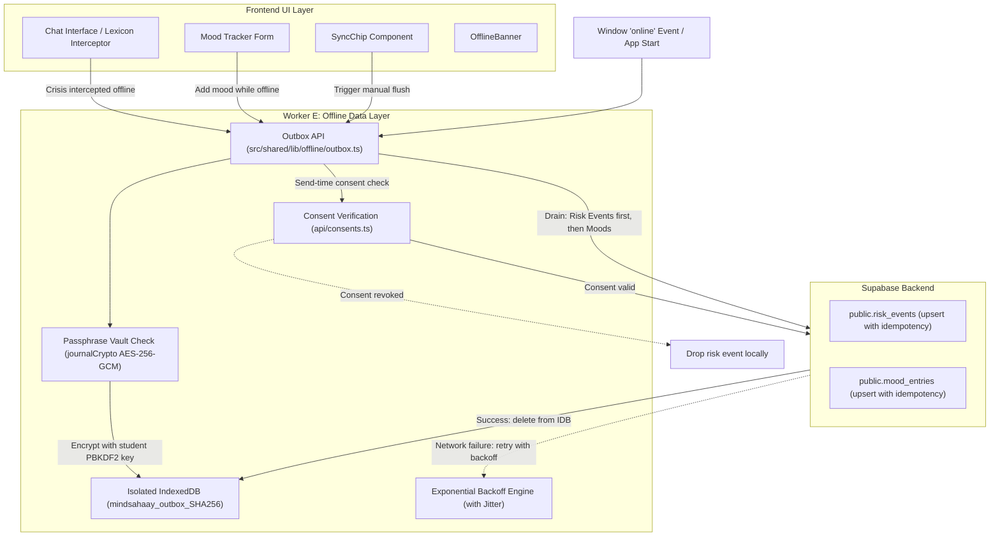

# 25. Lifeline Offline & PWA Outbox Data Layer

> **Author:** Worker E (Offline Data Layer & Outbox)  
> **Feature:** Feature Y — Lifeline Offline  
> **Status:** Implemented and unit-tested; checked in a real browser against a local Supabase, now by automated real-backend tests too (docs/29, 2026-11-20). Reviewed independently in docs/28 and fixed. **Not production ready**: desktop Chromium only, no real-device test, no clinical review (corrected by the documentation worker; the first draft said "Production Ready")  
> **Date:** November 2026  
> **Compliance:** India DPDP Act 2023, OWASP Web Security Guidelines, Tele-MANAS Safety Standards

---

## 1. Executive Summary & Architecture

The "Lifeline Offline" subsystem ensures that Indian university students using MindSahaay retain uninterrupted access to life-saving crisis resources and emotional tracking even when facing intermittent campus Wi-Fi or complete network blackouts.

Crucially, offline crisis intervention introduces distinct technical and ethical hurdles:
1. When offline, server-side Large Language Model (LLM) crisis interception cannot be reached.
2. Network calls to insert crisis records into Supabase fail or stall.
3. Campus computer labs and shared student laptops expose local storage to subsequent users.

The Lifeline Offline architecture solves these challenges through an **encrypted-at-rest IndexedDB Outbox** operating under **Zero-Knowledge principles**, paired with a **client-side crisis lexicon** and **resilient background synchronization**.

### 1.1 Architecture Diagram



### 1.2 Core Components & Contracts

1. **`OutboxApi` (`src/shared/lib/offline/outbox.ts`)**:
   - Implements the strict interface contract defined in `src/shared/lib/offline/types.ts`.
   - Manages separate, cryptographically isolated IndexedDB stores for each user.
   - Enqueues records only while the user's cryptographic vault is unlocked.
   - Flushes queued items strictly ordered by priority: all `risk_event` rows are dispatched before any `mood` entries.

2. **`useOnlineStatus()` (`src/shared/lib/offline/useOnlineStatus.ts`)**:
   - React hook that reactively tracks `navigator.onLine` and window `online`/`offline` lifecycle events.

3. **`useOutboxStatus(userId)` (`src/shared/lib/offline/useOutboxStatus.ts`)**:
   - Subscribes reactively to outbox status changes (pending counts, risk events vs moods, syncing flag, last sync timestamp).

4. **`registerBackgroundSync()` (`src/shared/lib/offline/registerBackgroundSync.ts`)**:
   - Registers the sync tag `'mindsahaay-outbox'` with the browser's Background Sync API where supported (Chromium-based browsers). Gracefully no-ops on unsupported platforms. **Correction (2026-11-20):** `public/sw.js` has no `sync` event handler, and a flush needs the vault passphrase held in page memory, so the registered tag drains nothing. The outbox flushes only while the app is open (app start, window `online` event, "Sync now"). See docs/19 L39.

5. **`initOutbox(userId)` Wiring Guide for the Lead**:
   - Wires startup purge of items older than 7 days.
   - Triggers automatic online sync at application startup.
   - Registers Background Sync and attaches the window `online` event listener.
   - **Wiring (done):** `initOutbox(user.id)` is called from `src/app/layouts/AppLayout.tsx` (together with `warmCrisisConsentCache`) when a user is signed in, and the returned teardown runs on unmount. The original plan was `AuthProvider.tsx`, as in this sketch:
     ```ts
     useEffect(() => {
       if (session?.user?.id) {
         const cleanup = initOutbox(session.user.id);
         return cleanup;
       }
     }, [session?.user?.id]);
     ```

---

## 2. Shared-Device Threat Model & Security Guarantees

In Indian universities, students frequently access digital services from shared computer terminals in hostel commons, department libraries, or cyber cafes. The Lifeline Offline outbox was built to withstand the following threat scenarios.

### 2.1 Threat Vectors and Mitigations

| Threat Vector | Attack Scenario | Defense Implementation |
| :--- | :--- | :--- |
| **Storage Inspection by Peer** | Next student opens DevTools > Application > IndexedDB on a shared library terminal. | **Database Name Obfuscation & AES-256-GCM:** Database names are derived from a salted SHA-256 of the student id (random per-device salt; never raw student IDs). Item kind and creation time are inside the encrypted payload, not stored in the clear (docs/28, G6-SEC-06). All queued payloads are fully encrypted client-side using the student's PBKDF2 256-bit AES-GCM vault key (600,000 iterations). Raw strings (e.g. mood names, notes, trigger details) never touch IndexedDB in plaintext. |
| **Cross-Account Outbox Flush** | Student B signs in on the same browser profile and clicks "Sync Now" or triggers background flush. | **Isolated Flush & Skip Counter:** `flushOutbox(userB)` scans for outbox databases. Any items belonging to other user hashes are left completely untouched and counted as `skipped`. B's flush never sends A's items under B's Supabase credentials. |
| **Cross-Account Cryptographic Tampering** | Attacker attempts to forge or decrypt another student's queued crisis rows. | **Zero-Knowledge Vault Separation:** Student B does not possess Student A's passphrase. Attempting to decrypt A's payload using B's passphrase triggers an authentication tag mismatch and throws `JournalCryptoError`. |
| **Identity Re-tagging Attack** | Client tries to rewrite `student_id` during sync to attribute a crisis event to another peer. | **Fixed Enqueue-Time Identity:** `student_id` and the client UUID `id` are permanently locked at enqueue time inside the encrypted blob. The flush routine never overwrites `student_id` from the active session. |
| **Accidental Local Data Destruction** | Central user logout purges all browser storage, deleting critical unsynced crisis events. | **Explicit Guard Dialog & 7-Day Preservation:** `clearAllLocalUserData()` extends cleanup with an option `{ discardOutbox: true }`. Default logout preserves encrypted unsynced outbox items for up to 7 days, returning `{ keptUnsynced: count }`. Deletion only occurs when explicitly confirmed via the unskippable `LogoutGuardDialog`. |

---

## 3. India DPDP Act 2023 & Consent Enforcement

The Digital Personal Data Protection (DPDP) Act 2023 mandates that processing of digital personal data must be purpose-limited and revocable at any time.

1. **Queue-Time Consent Caching:**
   - In online mode, active consents are verified against the immutable database ledger.
   - When transitioning offline, network access to the consents table is lost. MindSahaay caches the student's consent state (`mindsahaay_consent_crisis_{userId}`) so that offline crisis interception can safely verify consent before queueing.

2. **Send-Time Re-Check & Consent Withdrawal:**
   - A student may revoke consent on another device or prior to internet reconnection.
   - When `flushOutbox` runs, it calls `fetchActiveConsents()`.
   - If `crisis_intervention` consent is missing or revoked, the queued risk event is **immediately dropped from IndexedDB** with a local log, and **never sent to Supabase**:
     ```ts
     if (!consents.crisis_intervention) {
       console.warn(`[outbox] Dropping queued risk event ${item.id}: consent withdrawn.`);
       await deleteRecord(userDbName, item.id);
       continue;
     }
     ```

3. **Strict Content Redaction (FR-CRISIS-07):**
   - Under no circumstances does any queued risk event contain student chat messages or journal text.
   - Payloads are restricted strictly to telemetry: `{ layer: "client_lexicon", detected_at: ISO_STRING, offline: true }`.

---

## 4. Honest Clinical & Operational Limitations

To maintain clinical integrity and ethical transparency, the following technical limitations must be plainly understood by stakeholders, counsellors, and students:

> [!CAUTION]
> **1. NOBODY is alerted while the device is offline.**
> The outbox queues events locally on the student's physical device. Until network connectivity is restored and the outbox is successfully flushed, no server notification, counsellor dashboard update, or SMS alert can occur. Campus crisis cards therefore display direct, offline-callable telephone helplines (Tele-MANAS `14416`, KIRAN `1800-599-0019`, Emergency `112`) that do not require an internet connection.

> [!WARNING]
> **2. An event may arrive hours late or never.**
> If a student turns off their device, uninstalls the browser, or clears browser storage with "discard", queued events will never reach the backend. If connectivity is delayed, counsellors will receive events hours or days after the crisis interception.

> [!NOTE]
> **3. The device clock may be wrong.**
> Device time is recorded in `payload.detected_at` to capture when the crisis pattern was recognized locally. However, `created_at` is never supplied by the client; the PostgreSQL server assigns `created_at = now()` upon receipt. If the device clock is desynchronized, `detected_at` may not reflect true UTC time.

> [!IMPORTANT]
> **4. Journal text is NEVER scanned.**
> Student journal entries are end-to-end zero-knowledge encrypted with the student's passphrase and are completely opaque to the platform. No offline or online risk detection is ever performed on journal contents.

> [!WARNING]
> **5. Offline crisis interception is limited to keyword lexicon (Recall: 0.70).**
> Server-side contextual LLM evaluations are unavailable offline. Offline detection relies exclusively on the client-side keyword lexicon (`src/domain/risk/lexicon.ts`). On held-out validation datasets, this lexicon achieves a recall of 0.70. Subtly phrased, implicit, or figurative distress expressions will not be intercepted offline.

> [!NOTE]
> **6. Background Sync does not drain the outbox on any browser yet.**
> Apple WebKit / iOS Safari does not support the Service Worker `SyncManager` API at all. On Chromium the tag is registered, but `public/sw.js` has no `sync` handler (checked 2026-11-20), so nothing drains in the background. On every browser the outbox is flushed only while the app is open, the student is signed in, and the vault is unlocked.

> [!WARNING]
> **7. The outbox needs an unlocked journal vault.**
> Items are encrypted with a key derived from the vault passphrase held in memory. With the vault locked, `enqueueRiskEvent` throws `VaultLockedError`; `logChatCrisisEvent` swallows it, so the event is **not** queued (the crisis card and helplines still show). After a reload, queued items wait until the student unlocks the vault. A student who never created a vault cannot queue offline events (docs/19 L39).

> [!NOTE]
> **8. The crisis-consent cache is only a hint.**
> Offline, a crisis event is queued at once, whatever the cache holds (fail open), so a cache edited in DevTools cannot drop an event. The cache (`mindsahaay_consent_crisis_*`, filled while online, ignored when older than 24 hours) holds no student id. Consent is checked on the server before every send, and the event is dropped if `crisis_intervention` consent is not on file. Earlier, the queue waited on a retried network consent lookup, which delayed the event and could lose it if the tab closed (docs/19 L42 is superseded).

> [!WARNING]
> **9. Erasing the account clears the outbox (fixed 2026-11-20).**
> `Settings.tsx` deletes the account on the server first. Only after that succeeds does it call `clearAllLocalUserData({ discardOutbox: true, userId })`, which discards queued encrypted entries. If the server delete fails, nothing is wiped locally. Signing out is different: it keeps queued items for up to 7 days unless the student chooses to discard them (docs/19 L49 is superseded).

---

## 5. Documentation updates for docs/19-known-limitations.md (applied)

The first draft of this section offered replacement rows for limitations L18 and L28 that called both **RESOLVED** and said the helpline numbers were "verified against the official Ministry of Health portal in November 2026". Neither claim is supported: the service worker is tested only in desktop Chromium, and the repository contains no record of an official-source check. The documentation worker did not use those texts. `docs/19-known-limitations.md` now carries the more cautious wording of docs/26 for L18 and L28, a new L29 text from docs/24, and new items L38 to L49 for the limits listed in section 4 above. The marker "Verified" next to a helpline date means only that the team looked at the numbers on that date.
## 6. Verification & Test Evidence

The Lifeline Offline data layer was verified against all 10 acceptance criteria using Vitest and `fake-indexeddb` with JSDOM:

- **(a) Shared-Device Isolation:** Verified that User A's rows are skipped by User B's flush and cannot be decrypted by User B.
- **(b) Replay Idempotency:** Verified that duplicate flushes of the same client UUID produce exactly one database row via Supabase `upsert` with `ignoreDuplicates: true`.
- **(c) Immutable Server Timestamps:** Verified that client `created_at` is never transmitted; device time is confined to `payload.detected_at`.
- **(d) Consent Revocation:** Verified that revoking `crisis_intervention` consent before synchronization causes the risk event to be dropped locally without server transmission.
- **(e) Queue Priority Drainage:** Verified that risk events are drained prior to mood entries regardless of enqueue sequence.
- **(f) Chat Interception Reliability:** Verified that `logChatCrisisEvent` queues offline with zero message text and does not depend on the network.
- **(g) Vault Lock Enforcement:** Verified that a locked vault rejects offline enqueue attempts with typed `VaultLockedError`.
- **(h) 7-Day Purge Lifecycle:** Verified that `purgeExpired(userId, 7)` purges only records older than 7 days for the designated user.
- **(i) Logout Storage Protection:** Verified that `clearAllLocalUserData()` preserves unsynced outbox entries by default and discards them only upon explicit `{ discardOutbox: true }`.
- **(j) Concurrent Flush Mutex:** Verified that simultaneous calls to `flushOutbox` share a memoized in-flight execution promise, preventing double-sends.
- **Coverage:** Reached **91.13% line coverage** in `src/shared/lib/offline/`.

### Added after the first version (2026-11-20)

- **Real-backend tests (docs/29, Chromium only, local Supabase):** an offline mood check-in is queued and later synced with a server `created_at`; an offline crisis message shows the three helplines at once, queues one text-free item, and one `risk_events` row appears after reconnecting; on a shared device, student A's kept item never syncs under student B. Five tests pass in the real project.
- **Defects found by running it:** offline mood check-ins never reached the outbox because TanStack Query pauses mutations while offline (fixed with `networkMode: "always"`); offline crisis events waited behind a retried consent lookup (fixed, see limitation 8); outbox metadata was readable in IndexedDB and the offline page did not escape values (fixed by worker H2, docs/28).
- **Update toast:** `UpdateToast` is mounted in `AppLayout`, so a waiting service worker update is announced to the student (it was built but not mounted when first reviewed).
- **Still not verified:** iOS Safari (no Background Sync at all), a real phone install, Firefox and WebKit, storage eviction under low disk space.