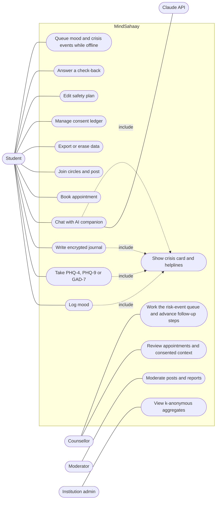

# Chapter 3. Requirements Analysis

The requirements follow the structure of IEEE 29148 and are recorded in full in docs/02-srs.md. This chapter summarises them, shows how they were derived, and reports how many were met. Requirement identifiers (FR-xxx for functional, NFR-xxx for non-functional) are used throughout the report.

## 3.1 Stakeholders and personas

Five personas are defined. **They are fictional.** They were written from the project's assumptions, not from interviews or a survey, and they remain assumptions until real needs elicitation confirms them.

**Table 3.1 Personas**

| Persona | Description | Key needs | Maps to role |
|---|---|---|---|
| Aarav | 19, first-year engineering student in a hostel, after a competitive entrance exam, homesick, reads Hinglish | Low-barrier anonymous check-ins, Hinglish companion | `student` |
| Priya | 22, final-year postgraduate, placement anxiety, privacy-conscious | Encrypted journal, evidence that data is not shared, export and erase | `student` |
| Dr. Ananya | Campus counsellor (fictional) | See only own appointments, set availability, receive student context only with consent | `counsellor` |
| Rohan | Peer-support volunteer and moderator | Review reported posts, remove harmful content, never see identity | `moderator` |
| Dean | Dean of Student Welfare | Aggregate trends only, with a minimum cohort size | `institution_admin` |

[STUDENT: insert survey results. Suggested content: sample size and recruitment method; share of respondents who would use an anonymous tool; language preference (English, Hindi, Hinglish); top concerns about privacy; whether personas match respondents. Ethics clearance is required first (Chapter 8).]

[STUDENT: insert interview themes. Suggested content: three to six themes with anonymised quotations from students and, ideally, a campus counsellor; any theme that contradicts the requirements below.]

## 3.2 Use cases

Figure 1 shows the use cases. Crisis display is an `include` of every free-text use case, so no text input is outside the safety path.

**Figure 1. Use-case diagram** (source: docs/05-uml.md section 1; not yet rendered by a tool)

## 3.3 Functional requirements

There are 53 functional requirements in seven groups (48 in the first draft, plus five crisis requirements added for the two features chosen in Section 4.14: the Crisis Follow-Through Loop and Lifeline Offline). Priorities are M (must), S (should), C (could). The table lists the groups and a representative subset. The complete list with verification methods is in docs/02-srs.md section 3.

**Table 3.2 Functional requirement groups**

| Group | Count | Representative requirements |
|---|---:|---|
| FR-AUTH | 7 | JWT-derived identity, never a client-supplied student ID (FR-AUTH-02). Append-only consent ledger (FR-AUTH-04). One-click JSON export (FR-AUTH-05) and erase (FR-AUTH-06). |
| FR-MOOD | 5 | Mood in at most three taps (FR-MOOD-01). Crisis check on free-text notes (FR-MOOD-05). |
| FR-ASSESS | 6 | Educational disclaimer before and after every result (FR-ASSESS-02). PHQ-9 item 9 non-zero triggers the crisis protocol regardless of total (FR-ASSESS-04). |
| FR-CRISIS | 13 | Crisis banner that cannot be dismissed without a deliberate action and offers one-tap dial links (FR-CRISIS-01). Fail-safe OR of keyword and LLM layers (FR-CRISIS-03). Crisis-flagged turns never go to free generation (FR-CRISIS-06). No automatic contact with the university (FR-CRISIS-08). New: a five-step recorded follow-up (FR-CRISIS-09), 24 h and 72 h check-backs (FR-CRISIS-10), overdue escalation by in-app notification (FR-CRISIS-11), offline queueing of a content-free event (FR-CRISIS-12), and honest not-monitored-24/7 wording (FR-CRISIS-13). |
| FR-AI | 9 | Replies in the language of the user (FR-AI-01). API key only on the server (FR-AI-04). Companion labelled as AI (FR-AI-06). Fallback after 4 s (FR-AI-09). |
| FR-BOOK | 7 | No double booking (FR-BOOK-02). Counsellor sees only own appointments and the student's alias (FR-BOOK-05). Urgent-help options beside booking (FR-BOOK-07). |
| FR-COMM | 6 | Posts under an alias, held for moderation (FR-COMM-02). Moderator view hides author identity (FR-COMM-03). |

## 3.4 Non-functional requirements

Table 3.3 lists the measurable non-functional requirements and the evidence status.

**Table 3.3 Non-functional requirements and evidence**

| ID | Requirement | Evidence in this draft | Status |
|---|---|---|---|
| NFR-PERF-01 | Lighthouse >= 90 on key pages | Not run | Not started |
| NFR-PERF-02 | Chat TTFT p95 < 2.5 s at 50 concurrent users | No load test | Not started |
| NFR-PERF-03 | Non-AI API p95 < 500 ms | No load test | Not started |
| NFR-A11Y-01 | WCAG 2.2 AA, zero open A/AA failures | Axe run: open violations remain (Section 6.5) | Partial |
| NFR-A11Y-02 | Contrast, focus, accessible names, modal behaviour | Some component tests; contrast failures found | Partial |
| NFR-A11Y-03 | Gentle motion, reduced motion honoured | Inspection only | Partial |
| NFR-QUAL-01 | Line coverage >= 80%; 100% of crisis branches | About 85% lines (measured scope); crisis branches below 100% | Partial |
| NFR-SAFE-01 | Crisis recall >= 0.95 on held-out set | Keyword layer 0.70 held-out; LLM and hybrid pending | Partial (not met) |
| NFR-SAFE-02 | False positive rate <= 0.20 | Keyword layer 0.000 on synthetic held-out | Partial |
| NFR-SEC-01 | OWASP ASVS L1, clean dependency audit | Not run | Not started |
| NFR-SEC-02 | TLS 1.2+, secrets only in environment | Inspection | Partial |
| NFR-PRIV-01 | Client-side journal encryption (AES-GCM, passphrase-derived key) | Implemented and unit tested | Implemented |
| NFR-PRIV-02 | Export and erase under 10 s | Not timed | Not started |
| NFR-AVAIL-01 | Crisis content offline after first load | A service worker caches the crisis page; Playwright reloads `/crisis` offline in desktop Chromium. Not tested on a phone | Partial |
| NFR-AVAIL-02 | Helpline numbers carry a verified date; a change replaces every cached copy | Cache name is a hash that includes the helpline file; unit and Playwright tests. The date is the team's own record | Partial |
| NFR-PRIV-03 | Offline queue encrypted per user, 7 days, no message text, deleted at logout only on choice | Unit tests with fake IndexedDB and a real-backend offline spec; erase now deletes on the server first and then discards the queue (L49 fixed) | Partial |
| NFR-USAB-01 | SUS >= 68 with n >= 12 | No study | Not started |
| NFR-I18N-01 | English and Hindi UI; Hinglish companion | Locale files exist; Hindi text not reviewed by a native or clinical reviewer | Partial |
| NFR-COMP-01 | Latest two versions of main browsers, low-end Android | Not tested | Not started |

## 3.5 Constraints

The helplines are fixed by the steering rules: Tele-MANAS 14416 and 1800-891-4416, KIRAN 1800-599-0019, emergency 112. Data must not be shared with the university. The design system fixes day and night themes (green and warm paper in day mode, slate and muted mint in night mode, no pure white) and a gentle motion budget of 0.2 to 0.3 s. Regulatory constraints are described by reference only: the DPDP Act 2023, the Mental Healthcare Act 2017 and the UGC guidelines [S2, S23, S27] **[VERIFY]**.

## 3.6 Traceability and status

The traceability matrix in docs/02-srs.md section 6 was first written by hand and is now machine-checked by `scripts/req-status.mjs`. The script verifies that every named file exists, recomputes the counts, and refuses an "Implemented" status that has no passing Vitest or Playwright test or that touches an open limitation or security finding. Requirement identifiers are still not embedded in test names, so the test column was assigned by reading what each file covers. Statuses are Implemented (code, at least one passing automated test, no open defect), Partial (code exists but part is missing, or the only test is SQL, or behaviour is unmeasured, or an open limitation applies), and Not started.

At the snapshot of 20 November 2026 the script reports the following for all 72 requirements (53 functional, 19 non-functional). The first draft of this chapter counted 65; seven rows were added with the two new features and none of them is Implemented. This is the honest count and it was deliberately not raised after the SQL was executed locally, because a hosted project has not been tried and pgTAP does not count as evidence for "Implemented" in the script.

**Table 3.4 Requirement status (script output)**

| Status | All (72) | Functional (53) | Non-functional (19) | Examples |
|---|---:|---:|---:|---|
| Implemented | 3 | 2 | 1 | FR-ASSESS-04 (PHQ-9 item 9 crisis path), FR-AI-06 (AI label), NFR-PRIV-01 (client-side encryption) |
| Partial | 60 | 49 | 11 | Most of FR-CRISIS and FR-AI, because the Claude route is unverified and the held-out recall is 0.70 against 0.95; FR-BOOK-02 because concurrency has not been exercised; all five new crisis requirements and the three new or changed availability and privacy requirements, because they were tested on desktop Chromium and a local Supabase only |
| Not started | 9 | 2 | 7 | FR-MOOD-03 (edit and delete of moods in the client), FR-COMM-06 (likes without identity), the performance, availability and usability requirements |

The main reasons for "Partial" are that the Claude and Daily.co routes are unverified, the SQL has not been run on a hosted project, held-out crisis recall is below target, no manual accessibility audit or user study exists, and some portal pages still show sample data (Chapter 9). The script reports 14 orphan test files as warnings (mostly new tests from other work not yet mapped to a requirement) and 0 errors.

## 3.7 Requirements that changed during implementation

Four deviations between the SRS and the code are worth recording because an examiner may ask about them.

1. **Mood scale.** The SRS specifies a five-point scale; the database and server validation use 1 to 10 (limitation L20).
2. **Appointment states.** The design had six states; the schema has four (scheduled, confirmed, completed, cancelled). No-show and reschedule are not handled (L21).
3. **Stories became circles.** The original "peer stories" model was replaced by circles with posts and comments.
4. **Consent purposes.** The enumeration in the database (data_processing, crisis_intervention, analytics, counsellor_sharing, peer_support, research) differs from the list in the SRS.
