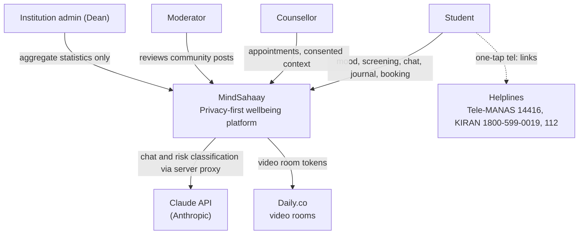
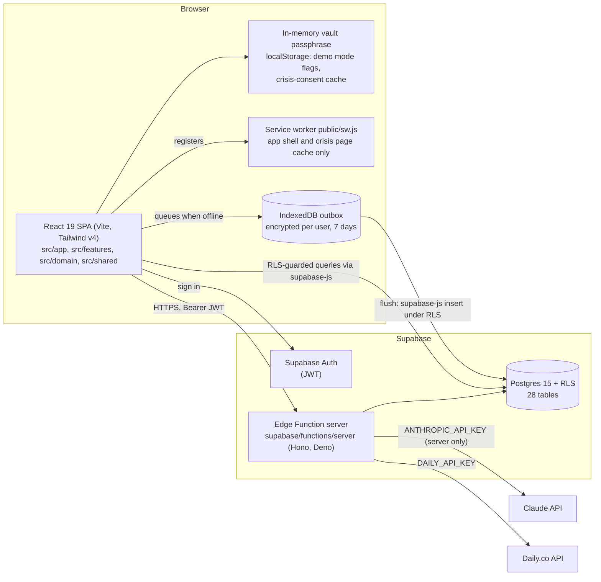
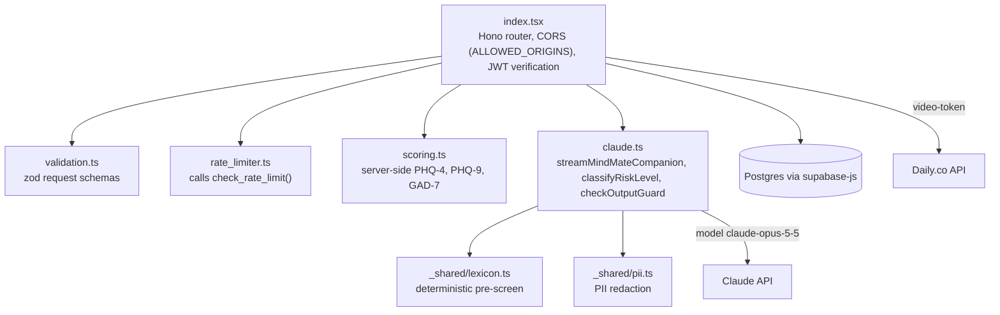
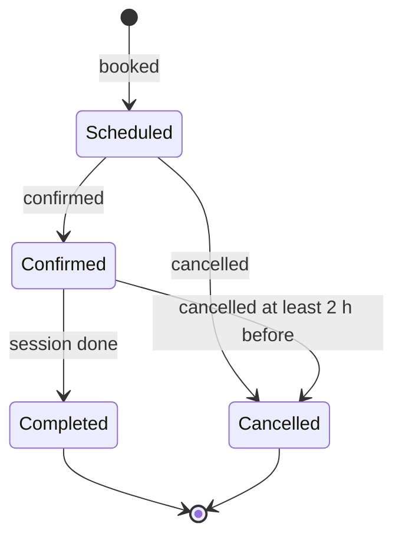
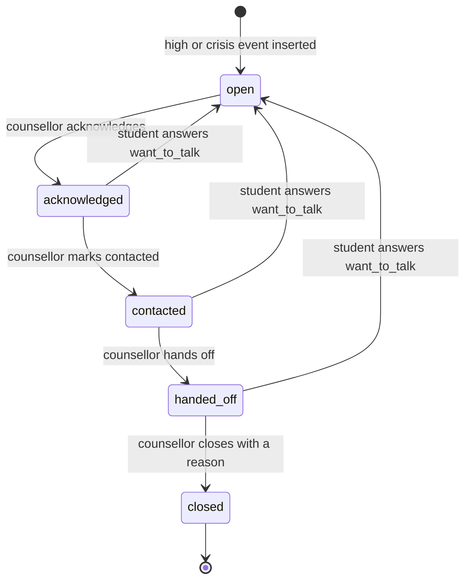

# Chapter 4. System Design

This chapter presents the architecture as built in the repository (docs/03-architecture.md, updated 20 November 2026), the data model (docs/04-erd.md), and the principal design decisions. Sections 4.12 to 4.14 were added for two features chosen late in the project: the Crisis Follow-Through Loop and Lifeline Offline. None of the Mermaid diagrams has been rendered by a tool; each was checked by reading. [STUDENT: render every diagram to an image (for example with mermaid-cli) and check it before submission, then replace the code blocks with images.]

## 4.1 Design principles

Five principles, derived from the steering rules and the threat model, guided the design.

1. **The safety path does not depend on the network or on a model.** Crisis detection and helpline display run in the browser as pure functions.
2. **Fail towards help.** When two detectors disagree, the more severe result wins. When the lexicon is unsure about an explicit first-person statement, it raises the level by one step.
3. **The operator should not be able to read what it does not need.** Journals are encrypted before leaving the device. Institution administrators can see only suppressed aggregates.
4. **Identity comes from the token.** The student identifier is derived from the verified session, never from a request parameter.
5. **Educational, not diagnostic.** Wording, labels and routing are built to avoid presenting a screening result as a diagnosis.

## 4.2 System context (C4 level 1)

Figure 2 shows the system and its external parties. The university administration is deliberately not a data recipient. The notification service in the original design was removed: notifications are rows in a table and no email provider is integrated.

**Figure 2. System context** (source: docs/03-architecture.md section 1)

## 4.3 Containers (C4 level 2)

The system has four runtime containers (Figure 3): a React 19 single-page application, Supabase Auth, a Postgres 15 database with row level security and 28 tables, and an edge function written with Hono for Deno. The browser keeps the journal passphrase only in memory. Local storage holds demonstration-mode flags and a per-user crisis-consent flag; an encrypted IndexedDB outbox and a service worker were added with Lifeline Offline (Section 4.13).

**Figure 3. Containers** (source: docs/03-architecture.md section 2)

Added on 20 November 2026 compared with the first version of this chapter: a hand-written service worker and an IndexedDB outbox (Section 4.13). The journal ciphertext still lives in Postgres, not IndexedDB. The file `supabase/functions/server/kv_store.tsx` is a leftover from the first prototype, which stored data under key-value keys and used the anonymous key as bearer token with the student identifier in the URL. That prototype weakness (TH-01 in the threat model) motivated the move to per-user JWTs and a relational schema.

## 4.4 Components

### 4.4.1 Browser application

The application is organised into `src/app` (providers, layouts, lazy routes with role guards), `src/features/*` (one folder per capability), `src/domain` (pure logic) and `src/shared` (typed API client functions, UI primitives). Table 4.1 lists the domain modules, which carry the safety-critical logic.

**Table 4.1 Domain modules**

| Module | Responsibility | Network access |
|---|---|---|
| `src/domain/scoring/phq4.ts`, `phq9.ts`, `gad7.ts` | Validate answers, compute totals, bands and flags; attach the educational disclaimer | None |
| `src/domain/risk/lexicon.ts` | Multilingual deterministic risk detector (version 2) | None |
| `src/domain/risk/riskRouting.ts` | Map risk level and PHQ-9 item 9 to an action and the mandatory helplines | None |
| `src/domain/crypto/journalCrypto.ts` | AES-256-GCM encryption, PBKDF2 key derivation, recovery code | None (WebCrypto) |

### 4.4.2 Edge function

Figure 4 shows the edge function. It verifies the JWT, validates requests with zod schemas, applies a database-backed token-bucket rate limiter, recomputes scores server-side, and calls Claude through a module that wraps a deterministic pre-screen, PII redaction, a risk classifier and an output guard.

**Figure 4. Edge function components** (source: docs/03-architecture.md section 3.2)

The REST surface, taken from `supabase/openapi.yaml`, comprises `/health`, `/assessments`, `/chat/stream`, `/me/export`, `DELETE /me`, `/moods`, `/dashboard`, `/appointments`, `/appointments/{id}/video-token`, `/moderation/classify`, `/institutions/{id}/analytics`, `/journals`, `/thought-records`, `/circles`, `/circles/{id}/posts` and `/safety-plan`.

The model identifier `claude-opus-5-5` is hard-coded in the edge function and in the evaluation scripts. It has not been confirmed to be a valid identifier for the account that will be used (limitation L24). If it is wrong every AI call fails, and the application falls back to its degraded mode.

## 4.5 Data model

The schema in `supabase/migrations/0001_core.sql` to `0008_realtime_publication.sql` defines 28 tables, all with row level security enabled. Table 4.2 groups them. A sixth migration, `0006_handoff_and_optout.sql`, adds no table. It adds the column `profiles.checkback_opt_out` and four functions: one that sets the opt-out for the signed-in student, and three for the warm handoff (a counsellor offers a free session slot, the student accepts or declines, an offer lapses after 24 hours). Migration `0007_security_fixes.sql` closes the findings of the independent review (docs/28) and `0008_realtime_publication.sql` adds `risk_events`, `risk_followups` and `notifications` to the Supabase Realtime publication, which had been empty. Neither adds a table, so the count stays at 28. The migrations therefore run from `0001` to `0008`.

**Table 4.2 Tables by migration**

| Migration | Tables |
|---|---|
| 0001 core | institutions, profiles, consents, mood_entries, assessments, journal_entries, safety_plans, risk_events, counsellors, availability_slots, appointments, session_notes, care_shares, notifications, audit_log (15) |
| 0003 rate limit | rate_limits (1) |
| 0004 community and booking | circles, circle_members, posts, comments, reports, thought_records, chat_sessions, chat_messages (8) |
| 0005 crisis follow-up | institution_backup_counsellors, risk_followups, risk_checkback_prompts, risk_checkbacks (4), with one enum, one view and two RPCs |

Migration 0002 adds triggers and views but no tables. The relationship structure is shown in Appendix B (Figure 10); attribute-level detail is in docs/04-erd.md.

Seven design features of the schema deserve explanation (the follow-up tables are explained in Section 4.12).

- **Roles.** The enumeration `user_role` has student, counsellor, moderator, institution_admin and super_admin. The persona "Dean" maps to `institution_admin`.
- **Consent ledger.** The `consents` table is append-only, enforced by a trigger. Withdrawal is a new row. The six purposes are data_processing, crisis_intervention, analytics, counsellor_sharing, peer_support and research.
- **Care shares.** A counsellor can read a student's assessments, safety plan and risk events only through an active `care_shares` row granted by the student. The helper `has_active_care_share()` is used in the policies.
- **Risk events.** The table `risk_events` records severity (low, medium, high, crisis), the trigger source (phq9_item9, chat_crisis, lexicon_match, manual, assessment_escalation) and a JSON payload. The design intent is that no message text is stored. The payload has not been verified to be free of text.
- **Encrypted text.** `journal_entries`, `thought_records` and `session_notes` hold ciphertext, an IV and (for the first two) a salt. `chat_messages` holds `encrypted_content`; who writes it and with which key is not confirmed (limitation L31).
- **Retention.** `chat_messages.retention_expires_at` defaults to 30 days after creation and `purge_expired_chat_messages()` removes expired rows. The 30-day default is a placeholder for a decision.
- **Atomic booking.** `book_appointment_atomic()` takes a `FOR UPDATE` lock on the availability slot. A GiST exclusion constraint prevents overlapping slots for the same counsellor.

## 4.6 Row level security

Policies are summarised in Table 4.3. The table was assembled by reading policy names and their first lines in the migrations; the exact `USING` and `WITH CHECK` expressions must be re-read in a security review. All 14 pgTAP files (146 tests, including the regression tests for the independent review in files 12 and 13) pass on a local Supabase Postgres; a hosted run is still needed (Chapter 6).

**Table 4.3 Access by role (summary)**

| Data | Student | Counsellor | Moderator | Institution admin |
|---|---|---|---|---|
| Profile, consents, moods, journals, thought records, chat, notifications | Own rows | None | None | None |
| Assessments, safety plan | Own rows | Via active care share | None | None |
| Risk events | Own rows; insert and read, **no update** since migration 0005 | Read and update with an active care share scoped to `risk_events` | None | Super admin may update |
| Follow-up steps, check-back prompts, check-back answers | Read own; answer a prompt once; no other write | Read for students who shared `risk_events`; advance steps only through an RPC | None | Super admin reads |
| Appointments | Own | Own as participant | None | None |
| Session notes | None | Own | None | None |
| Posts and comments | Read approved, write own | As student | Manage via `is_moderator()` | As moderator |
| Reports | File and read own | None | Read and update all | None |
| Aggregates | None | None | None | Suppressed views and summary function |

## 4.7 Crisis pipeline design

The crisis pipeline has four layers, ordered from most to least deterministic.

1. **Layer 0: static helplines.** The SOS control in the header reaches the `/crisis` route in one tap and shows the three helplines from a constant array, `MANDATORY_HELPLINES`. No network is needed once the application is loaded.
2. **Layer 1: PHQ-9 item 9 rule.** A non-zero ninth answer sets `item9Flag` and `requiresCrisisProtocol`, and routing always returns the crisis card with counsellor alert, whatever the total score.
3. **Layer 2: lexicon.** `detectRisk` runs on every free-text input (mood notes, journal save, chat, assessment text) and returns one of five levels: none, low, moderate, high, imminent.
4. **Layer 3: LLM classifier (server).** `classifyRiskLevel` in the edge function. The combination rule is "the more severe of lexicon and LLM". Because the LLM layer has never been evaluated, the safety argument does not currently rely on it.

A turn flagged high or imminent never receives a free-generated reply: the edge function returns an approved crisis response containing the helplines. This is requirement FR-CRISIS-06. The sequence is shown in Figure 6 (Chapter 5).

## 4.8 Appointment state machine

Figure 5 shows the four states implemented. The table default is `confirmed`, so rows may begin in that state. No-show and rescheduling are not implemented. The cancellation rule (at least 2 hours before the slot) is enforced client-side by `canCancel` with the constant `CANCEL_WINDOW_MS`; server enforcement was not confirmed.

**Figure 5. Appointment state machine** (source: docs/05-uml.md section 7)

## 4.9 Key decisions and trade-offs

**Table 4.4 Decisions**

| Decision | Reason | Cost |
|---|---|---|
| Server proxy for Claude | The API key never reaches the browser (FR-AI-04) | Extra network hop; TTFT unmeasured |
| Two lexicon copies (browser v2 and `supabase/functions/_shared/lexicon.ts`) | Works without the server; the server cannot be bypassed | The server copy is now generated from the browser copy by `scripts/sync-lexicon.mjs` (hash-checked) and must be regenerated after each lexicon edit (L19, resolved) |
| Postgres with RLS instead of key-value store | Per-user access enforced in the database | Executed on a local Supabase (14 pgTAP files, 146 tests, all passing); hosted project not tried (L10) |
| Follow-up as an append-only table with a trigger-enforced order and a `SECURITY DEFINER` RPC | The order and the audit trail cannot be skipped from the client | Rules live in SQL; thresholds have no clinical review (L44) |
| Offline queue encrypted with the journal vault key | No readable crisis metadata at rest on a shared device | Needs an unlocked vault; a student without one cannot queue (L39) |
| Service worker that never handles Supabase or authenticated requests | Nothing personal can be cached | Only the static shell and the crisis page work offline |
| Client-side journal encryption | The operator cannot read journals | A lost passphrase and recovery code means lost data (L30) |
| Crisis-flagged turns return a template | Predictable, reviewable output | Less personal reply |
| Demonstration mode in the front end | Examiners can run the app without a backend | Demo data is static and is not evidence of backend behaviour |
| Aggregates as database views with a suppression threshold | Suppression applied where the data lives | Threshold is k = 10 in SQL but 20 in the SRS and 50 in a static page (L14, L32) |

## 4.10 Accessibility and visual design

The design system (steering file `design-system.md`) fixes the following. Typography is a clear sans-serif hierarchy with line-height 1.5 to 1.7. Motion is limited to 0.2 to 0.3 s ease transitions with no flashing. Day mode uses botanical greens (`#19443c`, `#2f6a5b`) on a warm paper canvas (`#fbf8f3`). Night mode uses slate (`#0a0f12`), dark moss (`#101e1a`) and muted mint highlights (`#74c69d`) with no pure white. Interactive elements need visible `:focus-visible` outlines, icon-only buttons need accessible names, and modals must trap focus, close on Escape and offer an explicit close button. Section 6.5 reports how far the implementation meets these rules.

## 4.11 Internationalisation

The interface has English and Hindi locale files, loaded per feature (`src/features/*/locales/en.json` and `hi.json`) plus shared locale files. The companion mirrors the language of the user through a prompt instruction, which has not been evaluated. Hindi strings have not been reviewed by a native speaker or a clinical reviewer.

## 4.12 Crisis Follow-Through Loop

Before this feature a high-risk event was a row that a counsellor could tick "resolved". Nothing recorded who acted, what they did, or whether the student was ever asked how they were (limitation L29 said so). The loop adds a short, ordered, auditable path from "flag raised" to "closed with a reason", and a gentle way for the student to answer back. The full description, roles and limits are in docs/24-crisis-followup.md.

1. A `risk_events` row with severity high or crisis (never message text) makes a database trigger write the first step, `open`.
2. A counsellor who holds a current care share with scope `risk_events` sees the event in a queue (the `risk_queue` view) with the five steps, a live timer and an overdue badge. The counsellor can take only the next legal step through the RPC `advance_risk_followup`, which re-checks the care share and the order and writes the audit log. Closing needs a reason from a fixed list of five.
3. An event still at `open` after 4 hours (crisis) or 12 hours (high) triggers in-app notifications to counsellors holding a share, and after 2 more hours to the institution's backup counsellor. The check runs from `pg_cron` where that exists and also when a counsellor opens the queue.
4. When an event is acknowledged, two check-back prompts are created for the student, due after 24 and 72 hours. "I want to talk" reopens the event and notifies counsellors. An answer can never close or lower an event.
5. The student sees a plain status card on the Dashboard, always with Tele-MANAS 14416, KIRAN 1800-599-0019 and 112, and the card says when no counsellor can see the alert.

**Figure 11. Follow-up state machine** (source: docs/05-uml.md section 8 and docs/24-crisis-followup.md section 3)

A security defect found while designing it is worth reporting. The old UPDATE policy on `risk_events` let a student update their own row, so a signed-in student could mark their own open alert resolved and hide it from the counsellor queue. Migration 0005 removes that branch; a pgTAP test and a real-backend end-to-end test repeat the attempt (docs/06 TH-21).

**What the loop is not.** It is in-app only. Nobody is paged, no service has agreed to staff it, nothing is monitored 24/7, and the timings (4 h, 12 h, 2 h, 24 h, 72 h) and the closure reasons are engineering choices with no clinical review. Migration 0006 added the warm handoff (a counsellor offers a session slot, the student accepts in the app) and a server-side check-back opt-out; both are covered by unit, pgTAP (22 tests) and UI tests, with no real-browser end-to-end check of the handoff flow. An independent review (docs/28) found a Critical defect: when a student answered "I want to talk" the event reopened, but the overdue job did not escalate it a second time, because notification idempotency was per event instead of per follow-up cycle, so a reopened event could sit unread. Migration 0007 fixed it (idempotency per cycle), together with an alias leak through a `SECURITY DEFINER` helper, permission and concurrency gaps in the escalation RPC, a revoked care share that still counted as active, and spoofable notifications; the tests were written first and are in pgTAP files 12 and 13.

## 4.13 Lifeline Offline

The aim is that a student who loses the network still reaches the helplines, and that a record of a crisis detected offline is not silently lost. Two parts, described in docs/25-offline-pwa.md and docs/26-pwa-shell.md.

- **Service worker and manifest.** A hand-written worker (`public/sw.js`, filled in at build time by a Vite plugin) caches the app shell, the `/login`, `/crisis`, `/chat` and `/dashboard` chunks and an offline page after one online visit. It never intercepts Supabase, `/functions/`, `/rest/`, `/auth/`, `/realtime/`, `/storage/`, requests with an `Authorization` header or any non-GET request, so nothing personal is cached. The cache name is a hash that includes the helpline source file, so changing a number or its "last verified" date replaces every cached copy at the next release. The crisis page and the offline page show that date.
- **Encrypted outbox.** While offline, a mood entry or a content-free risk event (`layer`, `detected_at`, `offline`) is encrypted with the student's vault key (AES-256-GCM, PBKDF2 with 600,000 iterations) and stored in an IndexedDB database named from a hash of the user id. After reconnection the outbox sends risk events before moods, checks the crisis consent again at send time (a withdrawn consent drops the item), uses the client UUID so a replay creates one row, and never sends `created_at`: a database trigger sets it, so an event cannot be back-dated. Items are kept at most 7 days. At logout the student must choose to keep or discard unsent items.

**Limits that matter.** Nobody is alerted while the device is offline, and an event may arrive hours late or never. The device clock may be wrong. Offline detection uses the keyword lexicon only (held-out recall 0.70). Queueing needs an unlocked journal vault and a crisis-consent flag cached while online. A Background Sync tag is registered but the worker has no handler, so nothing drains while the app is closed. The service worker was tested in desktop Chromium only, not on a phone. Erasing the account deletes on the server first and then wipes local data, discarding the outbox (the earlier gap, L49, is fixed). Real-browser tests cover the offline mood and crisis outbox and the shared-device case; Firefox, WebKit and real-device installation were not tested, and iOS Safari has no Background Sync. The first draft of the documentation called this feature "production ready"; that was wrong and was corrected.

## 4.14 How the two features were chosen

The project used a structured selection to decide which two features to build late in the project, because the time left allowed only two. The full record is in docs/30-feature-selection-tournament.md; this section summarises it. A "courtroom tournament" was run with AI agents (Claude Opus): six advocate agents each argued for one candidate feature after reading the repository, and one judge agent scored them against a fixed rubric. There were two elimination rounds, which left two features.

**Candidates.** (1) Weekly Reflection, an AI-written weekly letter from the student's own numbers. (2) Saathi Listener Desk, anonymous text sessions with a trained student volunteer. (3) Crisis Follow-Through Loop, a five-state follow-up protocol for high-risk events. (4) Pariksha Mode, an exam-aware sleep and routine diary kept on the device. (5) Campus Pulse, a k-anonymous counselling-capacity forecast for the dean. (6) Lifeline Offline, an installable offline-first PWA with an encrypted outbox.

**Rubric weights.** Capstone grade value 30%, real-world impact and honesty about it 20%, fit with existing code and feasibility 20%, safety, privacy and ethics 20%, candour about the weakest point 10%.

**Round 1** eliminated Campus Pulse (weighted score 6.1: the forecast would be trained on synthetic data the team writes, it goes dark on small campuses, and it had the lowest real-world value) and Saathi Listener Desk (6.0: its own stated failure mode is a suicidal student talking to an untrained peer with no service behind them). **Round 2** cross-examined the four survivors, and Weekly Reflection (7.3) and Pariksha Mode (7.2) were eliminated; the two winners scored 8.4 (Crisis Follow-Through Loop) and 7.9 (Lifeline Offline). The judge chose them because they work at different layers (clinical workflow in the database, client infrastructure) and connect: a crisis event queued offline arrives in the follow-up loop labelled with its detection and receipt times. The judge also set mandatory acceptance conditions for the offline queue (shared-device isolation, replay safety, server-set timestamps, consent re-checked at send time, an offline browser test and a plain statement that nobody is alerted while a device is offline); they became tests. The scores are the judge agent's ordinal judgements, not measurements.

The process had one concrete result beyond the choice: the fact-check surfaced the RLS defect that let a student update their own risk event (Section 4.12). Building and running the features later found further defects that tests had missed, reported in Chapter 6.
This method has limits that should be stated. The panel and the judge were language models, so their preference reflects what such models find persuasive, not what students need. No student, counsellor or clinician was consulted, so the choice is not evidence that these two features are the most useful. The result is a reasoned decision, not a validated one. [STUDENT: say whether the supervisor agreed, and what you would test with real users.]