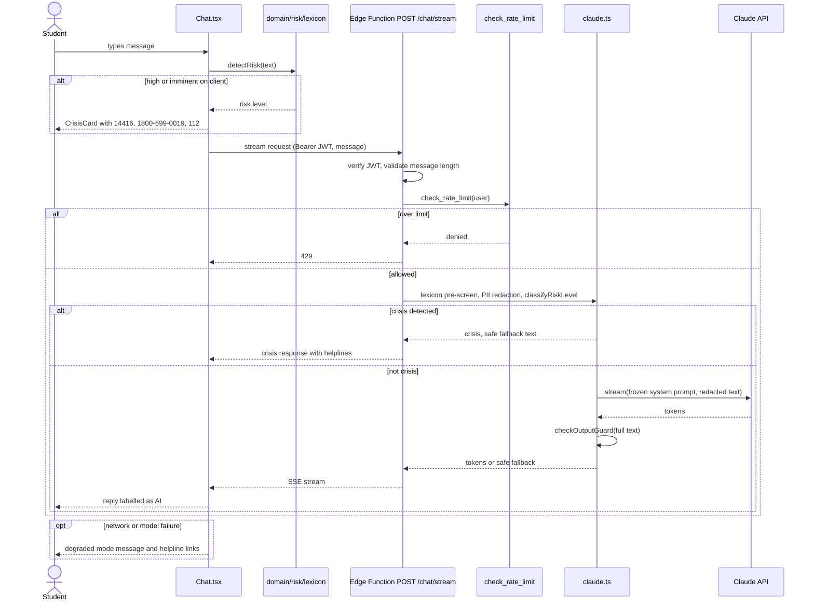
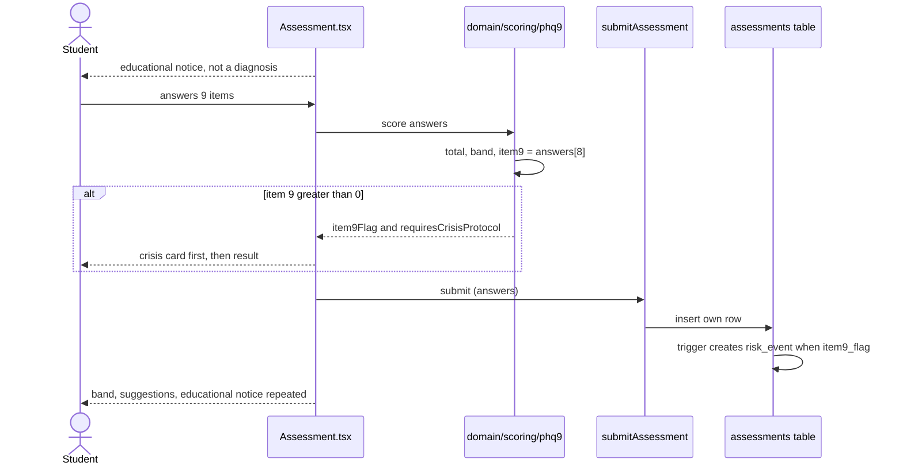
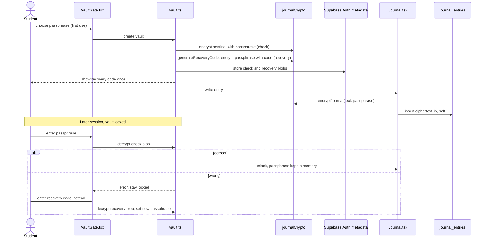
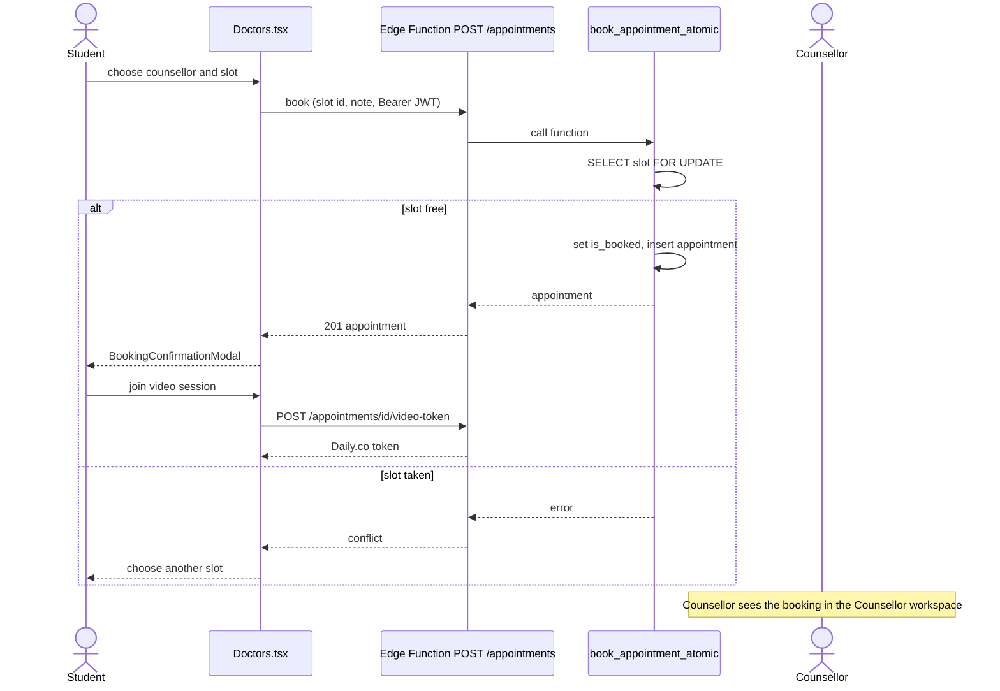

# Chapter 5. Implementation

This chapter walks through the parts of the implementation that carry the safety and privacy claims, with real file paths. Other features (mood, CBT toolkit, community, doctors) follow conventional patterns and are described briefly.

## 5.1 Technology stack and repository layout

The front end uses React 19, Vite, Tailwind CSS v4 (through the `@tailwindcss/vite` plugin), TypeScript 5.7 and oxfmt for formatting. Data fetching uses TanStack Query and validation uses zod. The entry contract is `src/main.tsx`, which mounts `src/App.tsx` into `#root`. The back end is Supabase (Auth, Postgres 15, Edge Functions) with a Hono application on Deno. Tests use Vitest 5.1.1 with jsdom and V8 coverage, MSW for network mocks, and Playwright with axe for end-to-end and accessibility checks.

**Table 5.1 Repository layout (principal paths)**

| Path | Contents |
|---|---|
| `src/domain/scoring`, `risk`, `crypto` | Pure domain logic and its tests |
| `src/features/*` | admin, assessment, auth, cbt, chat, community, consent, counsellor, crisis, dashboard, doctors, followup, insights, journal, modals, mood, navigation, offline-ui, onboarding, settings, stories |
| `src/app` | `routes.tsx` (lazy routes, role guards), providers (Auth, Query, I18n), layouts (App, Auth, DemoBanner, NotFound) |
| `src/shared/lib/api` | Typed client functions: account, assessments, chat, consents, journal, moods, safetyPlan, sessionHelper |
| `src/shared/lib/offline`, `src/shared/lib/pwa` | The encrypted outbox and its hooks; service-worker registration, helpline data and the cache version hash |
| `public/sw.js`, `public/offline.html`, `public/manifest.webmanifest` | Service worker template (filled in by a Vite plugin at build time), offline page, install manifest |
| `supabase/migrations` | `0001_core.sql` to `0008_realtime_publication.sql` (eight migrations; 0006 handoff and opt-out, 0007 review fixes, 0008 Realtime publication) |
| `supabase/functions/server` | `index.tsx`, `claude.ts`, `validation.ts`, `rate_limiter.ts`, `scoring.ts` |
| `supabase/tests` | pgTAP files `01` to `14` (14 files, 146 tests, all passing on a local Supabase Postgres; files 12 and 13 are the regression tests for the independent review and file 14 checks the Realtime publication; not run on a hosted project) |
| `eval/` | Dataset, splits, results; `scripts/eval-*.ts` evaluators |
| `e2e/` | Playwright specs: `smoke`, `journeys`, `a11y`, `pwa`, `offline-ui`, and an opt-in `real/` folder that talks to a local Supabase |

## 5.2 Educational scoring

### 5.2.1 Algorithm

Each scorer validates its input, sums the items and maps the total to a band. Validation is strict: the array must have exactly the right length and every element must be an integer from 0 to 3. Invalid input throws a `TypeError`, so a malformed answer set can never silently produce a score. The PHQ-9 scorer in `src/domain/scoring/phq9.ts` is:

```text
scorePHQ9(answers):
    if not (length == 9 and every a is integer and 0 <= a <= 3): throw TypeError
    total      = sum(answers)
    item9      = answers[8]
    item9Flag  = item9 > 0
    band       = minimal      if total <= 4
                 mild         if total <= 9
                 moderate     if total <= 14
                 moderately severe if total <= 19
                 severe       otherwise
    return { total, band, item9Score, item9Flag,
             requiresCrisisProtocol: item9Flag, disclaimer }
```

The band is computed independently of the flag. A student with a total of 2 and an item 9 answer of 1 receives the "minimal" band and the crisis protocol.

### 5.2.2 Score bands

**Table 5.2 Bands implemented** (thresholds as written in the source; to be checked against the instrument publications [S10, S11] **[VERIFY]**)

| Instrument | Items | Range | Bands (total score) |
|---|---:|---|---|
| PHQ-4 | 4 | 0 to 12 | normal 0-2, mild 3-5, moderate 6-8, severe 9-12. Subscale flags: anxiety (items 1-2) >= 3 and depression (items 3-4) >= 3 |
| PHQ-9 | 9 | 0 to 27 | minimal 0-4, mild 5-9, moderate 10-14, moderately severe 15-19, severe 20-27 |
| GAD-7 | 7 | 0 to 21 | minimal 0-4, mild 5-9, moderate 10-14, severe 15-21 |

Each result carries the disclaimer: "MindSahaay assessments are educational screening tools and do not constitute a clinical diagnosis or medical evaluation." The comments in the code use labels such as "Moderate depression". Those labels read like diagnoses, and the user-interface wording should be softened to educational bands after clinical review (limitation L27). The PHQ instruments' licence terms and any approved Hindi translations have not been checked.

The same scoring logic exists on the server in `supabase/functions/server/scoring.ts`, so the server recomputes the flag from raw answers and a client cannot suppress item 9 (threat TH-04). A database trigger, `handle_assessment_crisis_trigger`, creates the `risk_events` row when `item9_flag` is true, and it is the single source of truth: an earlier version also inserted a risk event from the edge function, so one PHQ-9 item 9 answer produced two risk events and two audit rows. The second insert was removed. The trigger is covered by the local pgTAP suite, and on 2026-11-20 a PHQ-9 submission with item 9 = 2 through the real edge function and a real JWT stored the assessment and created a crisis risk event with helplines. A hosted project has not been tried.

## 5.3 Risk detection

### 5.3.1 Lexicon pipeline

`src/domain/risk/lexicon.ts` (version 2) is a deterministic detector for English, Devanagari Hindi and romanised Hinglish. It runs without a network. The header of the file documents six stages.

1. **Segmentation.** Text is split into sentences and clauses. Commas and contrastive words ("but", "lekin") end a clause so that negation or fiction scope cannot leak across clauses.
2. **Quote masking.** Quoted spans are masked when the sentence is about a song, poem, novel or show.
3. **Normalisation and three views.** `normalizeText` applies Unicode NFC, lower-casing, removal of zero-width characters, removal of the Devanagari nukta, conversion of chandrabindu to anusvara, apostrophe stripping ("can't" becomes "cant"), collapse of three or more repeated characters and punctuation to spaces. Three matching views follow: an English view (slang contractions, typos of "suicide", "kms"), a romanised Hinglish view (vowel-run folding, spelling variants such as "nhi" to "nahi", gender forms mapped to one token) and a Devanagari view (nasal conjuncts folded to anusvara). Harmless idioms and "no plan" phrases are stripped.
4. **Rule application with suppression.** A rule hit is dropped if it is negated ("I would never hurt myself", "marna nahi chahta") or if the clause is about fiction or lyrics and the speaker is not "I". Rules that contain their own negation ("don't want to live") are never negated again. Dropped hits are returned in a `suppressed` array for audit.
5. **Graded levels.** Partial signals give moderate. Explicit ideation gives high. Ideation or a plan combined with time, intent, decision, farewell or means gives imminent.
6. **Escalation.** For explicit first-person statements that the rules mark as unsure, the level is raised by one step (the "when unsure, escalate" policy), and the result is marked `escalated`.

The result type is `{ level, categories, matches, normalizedText, escalated?, suppressed? }`, with levels `none`, `low`, `moderate`, `high`, `imminent` and categories `suicidal_intent`, `self_harm`, `hopelessness`, `distress`, `academic_stress`, `isolation`.

The lexicon cannot understand paraphrase. Version 2 misses euphemisms ("sleep and not wake up", "unalive"), attempts in progress ("I took something to make it all stop"), passive ideation without the key phrase, and Hindi paraphrases (Chapter 6). It does not handle tense or conditionals, so "I used to want to die" is still flagged, which is the safe direction.

### 5.3.2 Routing

`src/domain/risk/riskRouting.ts` is a pure function from a risk level and an optional PHQ-9 item 9 score to an action. Table 5.3 shows the matrix.

**Table 5.3 Routing matrix**

| Condition | Action | Crisis card | Counsellor alert (inside platform) |
|---|---|---|---|
| PHQ-9 item 9 > 0 (any level) | `crisis_card_plus_counsellor_alert` | Yes | Yes |
| Level `imminent` | `crisis_card_plus_counsellor_alert` | Yes | Yes |
| Level `high` | `crisis_card_plus_counsellor_alert` | Yes | Yes |
| Level `moderate` | `supportive_plus_resources` | No | No |
| Level `low` or `none` | `normal_reply` | No | No |

Every result carries the three mandatory helplines from the array `MANDATORY_HELPLINES`: Tele-MANAS (14416 and 1800-891-4416, 24/7), KIRAN (1800-599-0019, 24/7) and the national emergency number 112. The function `routeDetectedRisk` never lowers a level, never reads message text, and adds a sentence to the rationale when the escalation policy applied, so the audit trail explains why a level was raised. The "alert counsellor" outcome is an in-platform flag. No real counselling service has agreed to receive or act on such alerts (limitation L29), and the university is never contacted.

### 5.3.3 Chat pipeline

Figure 6 shows the sequence for one chat message. The browser runs the lexicon before the network request, so the crisis card appears even if the server is down. On the server the order is: JWT verification, message validation (maximum 3,000 characters), rate limiting, lexicon pre-screen, PII redaction, risk classification, and only then the model call with a frozen system prompt. The completed model output passes `checkOutputGuard`; a violation replaces the reply with a safe fallback. Because the guard runs on the completed text, a violation is detected after streaming. How the interface handles that replacement was not confirmed.

**Figure 6. Chat with crisis handling** (source: docs/05-uml.md section 3)



The chat user interface (`src/features/chat/Chat.tsx`) labels the companion as an AI, offers a "clear conversation" action with a second confirmation, and shows a degraded-mode message with helpline links when the stream fails (`CrisisCard.tsx`, `HelplineLinks.tsx`). The crisis card for chat has no close control.

### 5.3.4 Assessment sequence

Figure 7 shows the PHQ-9 flow. The crisis card appears before any score.

**Figure 7. PHQ-9 screening** (source: docs/05-uml.md section 5)



## 5.4 Client-side journal encryption

### 5.4.1 Parameters

`src/domain/crypto/journalCrypto.ts` uses the browser WebCrypto API. Table 5.4 lists the parameters, copied from the constants in the file.

**Table 5.4 Cryptographic parameters**

| Item | Value |
|---|---|
| Key derivation | PBKDF2 with SHA-256, 600,000 iterations (`PBKDF2_ITERATIONS`) |
| Derived key | AES-GCM, 256 bits (`AES_KEY_BIT_LENGTH`), non-extractable |
| Salt | 16 random bytes per entry (`SALT_BYTE_LENGTH`) from `getRandomValues` |
| IV | 12 random bytes per entry (`IV_BYTE_LENGTH`) |
| Authentication | AES-GCM tag (128 bit), so a wrong passphrase or tampered data fails to decrypt |
| Stored fields | `ciphertext`, `iv`, `salt` (Base64), plus `iterations` and `algorithm` in the client payload |
| Recovery code | 16 characters in four groups of four, from a 31-character alphabet without 0, O, 1, I, L |

The recovery code has about 79 bits of nominal entropy (16 times log2 of 31, computed here). The generator reduces a random byte modulo 31, which introduces a small bias because 256 is not a multiple of 31. The bias is minor for a 16-character code but rejection sampling would remove it. This was noticed during the write-up and is recorded as a possible improvement.

### 5.4.2 Algorithm

```text
encryptJournal(plaintext, passphrase):
    salt <- 16 random bytes ; iv <- 12 random bytes
    key  <- PBKDF2(passphrase, salt, 600000, SHA-256) -> AES-GCM-256
    ct   <- AES-GCM-encrypt(key, iv, UTF-8(plaintext))
    return { base64(ct), base64(iv), base64(salt), iterations, "AES-GCM" }

decryptJournal(payload, passphrase):
    key <- PBKDF2(passphrase, base64decode(payload.salt), payload.iterations or 600000)
    return UTF-8(AES-GCM-decrypt(key, iv, ct))     # throws JournalCryptoError on failure
```

A fresh salt per entry means that each entry needs a separate 600,000-iteration derivation. This is slow by design for guessing and acceptable for single-entry reads, but loading a long history costs time proportional to the number of entries. Performance of bulk decryption was not measured.

### 5.4.3 Vault and recovery

`src/features/journal/vault.ts` holds the passphrase in memory only (a module variable exposed with `useSyncExternalStore`) and requires at least 8 characters. To check a passphrase before any entry exists, and to allow recovery, the vault stores two ciphertext blobs in the user's authentication metadata under `journal_vault`: `check = encrypt("mindsahaay-vault-v1", passphrase)` and `recovery = encrypt(passphrase, recoveryCode)`. The server therefore sees only ciphertext. If the passphrase and the recovery code are both lost, the entries are unreadable to everyone, including the operator (limitation L30). Figure 8 shows the flow. The exact first-use and reset steps in `VaultGate.tsx` were not traced line by line, so the diagram must be checked against the component.

**Figure 8. Journal vault and recovery** (source: docs/05-uml.md section 6)



In demonstration mode the journal route renders a demo view that skips the vault, so the passphrase set-up cannot be exercised without a Supabase session (an end-to-end test for it is marked as a known failure).

## 5.5 Aggregate privacy: k-anonymity views

Institution administrators have no policy that exposes individual rows. They read three views defined in migration `0002_triggers.sql`: `institution_assessment_aggregates`, `institution_mood_aggregates` and `institution_risk_aggregates`, and a function `get_institution_wellbeing_summary(p_institution_id)` that raises an exception unless the caller is an institution administrator.

The assessment view groups by institution, instrument, severity and calendar month and suppresses small groups:

```sql
CREATE OR REPLACE VIEW public.institution_assessment_aggregates AS
SELECT p.institution_id, i.name AS institution_name, i.code AS institution_code,
       a.instrument, a.severity,
       date_trunc('month', a.completed_at)::date AS report_month,
       count(*)::integer AS sample_size,
       round(avg(a.total), 2) AS mean_score,
       sum(CASE WHEN a.item9_flag THEN 1 ELSE 0 END)::integer AS crisis_indicators
FROM public.assessments a
JOIN public.profiles p ON p.id = a.student_id
JOIN public.institutions i ON i.id = p.institution_id
GROUP BY p.institution_id, i.name, i.code, a.instrument, a.severity,
         date_trunc('month', a.completed_at)
HAVING count(*) >= 10;
```

Any group with fewer than ten records is omitted (k = 10). Three weaknesses were found on reading, and none has been tested. First, k-anonymity as a floor does not stop differencing attacks across months or views, or inference in small institutions (L32). Second, the SRS and threat model say k = 20 and a static admin page displays 50, so the three documents disagree. Third, the views are granted `SELECT` to the `authenticated` role without a role check in the view body; in Postgres a view owned by a privileged role normally bypasses row level security on its base tables, so any signed-in user might be able to read the aggregates of any institution unless the grant is tightened or the view is created with `security_invoker`. This is a finding from reading the SQL and must be confirmed or refuted by executing it.

## 5.6 Booking and rate limiting

Booking calls `book_appointment_atomic()`, which selects the availability slot with `FOR UPDATE`, checks it is free, sets `is_booked` and inserts the appointment in one transaction. Concurrent requests for the same slot serialise on the lock, and the second sees the slot taken. Overlapping slots for one counsellor are prevented by the GiST constraint `no_overlapping_slots` (extension `btree_gist`). The concurrency behaviour was never exercised against a database. The video session link uses a Daily.co room token through `POST /appointments/{id}/video-token` and requires `DAILY_API_KEY`.

**Figure 9. Booking** (source: docs/05-uml.md section 4)



Rate limiting is a token bucket stored in the table `rate_limits` and evaluated by the SQL function `check_rate_limit()`; the table is revoked from all client roles. The server README states 20 requests per minute. No test covers it.

## 5.7 Consent, export and erasure

The consent ledger (`src/features/consent/ConsentLedger.tsx`, `src/shared/lib/api/consents.ts`) shows per-purpose toggles with opt-in defaults and gates on 18+ and core consent in the end-to-end journeys. Withdrawal inserts a new ledger row. Export (`exportStudentData`, `GET /me/export`) covers profile, consents, moods, assessments, journals, safety plan and appointments; chat and thought records are not in the client export schema. Erasure (`deleteStudentAccount`, `DELETE /me`) requires typing DELETE in the interface and relies on `ON DELETE CASCADE` from `profiles`. The consent table is append-only by trigger and the cascade from the profile is allowed to delete its rows; pgTAP file `04` (append-only behaviour) passes on the local database (docs/04-erd.md section 3). The client deletes on the server first and wipes local data, including the unsent outbox, only after that succeeds.

## 5.8 Demonstration mode and legacy code

Demonstration mode (`src/features/auth/demoMode.ts`) provides five canned users (student, counsellor, moderator, institution_admin, super_admin) so that examiners can run the application without a backend. The routed pages `/counsellor`, `/moderator` and `/admin` are static mock pages (`src/features/dashboard/*Portal.tsx`). The API-backed components exist and are tested (`src/features/counsellor`, `src/features/community/ModeratorQueue.tsx`, `src/features/admin`) but are not mounted on those routes. The legacy client `src/api.ts` and mock data in `src/shared/data/mockData.ts` are still imported by `Dashboard.tsx`, `PrivacyModal.tsx` and `CampusStories.tsx`. These are listed as limitations L14 and L15 and must not be presented as working role workflows.

## 5.9 Build and performance observation

The first route (`/login`) now loads about 190.9 KB gzipped, inside the 200 KB budget. It was 246.9 KB (16 JavaScript files, 852 KB raw) before the Supabase SDK and the Hindi locale were lazy-loaded; the largest parts at that time were `index` (104 KB), `supabase` (56 KB), `sessionHelper` (26 KB), `context` (16 KB) and `lexicon` (14 KB). The charting library (112 KB gzipped) is lazy-loaded and not on the first route. This is a bundle size measurement only: Lighthouse has not been run.

## 5.10 Crisis Follow-Through Loop

The loop (Section 4.12) is implemented mostly in SQL, so that a client cannot skip it. Four pieces carry the weight.

- **Order is enforced by a trigger.** `validate_risk_followup_transition` (migration 0005) reads the latest step by a generated sequence number and accepts only the next legal one. It refuses a jump (open to contacted), a step on a closed event, a closing without one of five reasons, and a return to `open` unless the check-back trigger has set a session flag. The table is append-only: triggers refuse UPDATE and direct DELETE, and a cascade delete from the profile is allowed so erasure still works.
- **Counsellors act through one RPC.** `advance_risk_followup(event, step, closure_reason, note)` is `SECURITY DEFINER` with a fixed `search_path`. It checks that the caller is a verified counsellor with a current care share scoped to `risk_events` (or a super admin), refuses `open`, inserts the step and writes `audit_log` with the step and reason but no note text.
- **Students can only answer.** `risk_checkbacks` accepts one row per prompt, for the student's own prompt, and refuses edits. A trigger turns "want to talk" into a new `open` step and a notification to counsellors holding a share. A student's answer can never close an event.
- **The overdue check is idempotent.** `escalate_overdue_risk()` computes the age of the current `open` step, notifies counsellors with a share at level 1 and the institution's backup counsellor at level 2, and writes one notification per (follow-up cycle, level). Migration 0007 also fixed permission and concurrency gaps in the escalation RPC. The counsellor queue calls it when opened and every 5 minutes while open, because `pg_cron` is not available everywhere.

On the client, `src/features/counsellor/RiskQueue.tsx` shows the queue and offers only the next legal step, and `src/features/followup/FollowUpCard.tsx` shows the student's status. Both always print the not-monitored-24/7 limits and the three helplines. They render only two payload fields (`offline`, `detected_at`), and the `risk_queue` view returns only those two keys of the payload. Migration 0006 adds the warm handoff (RPCs `offer_handoff_slot`, `accept_handoff_offer`, `decline_handoff_offer`, shown on the queue as "Offer a session" and on the student card as "Accept this session" and "Not now") and a server-side check-back opt-out (`profiles.checkback_opt_out`, RPC `set_checkback_opt_out`). Tests: pgTAP files 08 to 11 (66 tests), Vitest in `src/features/counsellor` and `src/features/followup` (73 tests reported by the author) and a real-backend Playwright spec. The Critical defect from the independent review (docs/28), that the overdue job did not escalate an event again after the student reopened it, is fixed in migration 0007: notification idempotency is now per follow-up cycle, not per event (pgTAP files 12 and 13, written to fail first). The handoff and opt-out flow has unit, pgTAP and UI tests but no real-browser end-to-end check.

## 5.11 Lifeline Offline

- **Detection offline.** The keyword lexicon runs in the browser, so the crisis card and the three helplines appear at once with no network. `logChatCrisisEvent` then tries to record the event. If the device is offline it reads the cached crisis consent (filled while online, cleared at logout) instead of waiting on the network, and queues a risk event with `layer`, `detected_at` and `offline` only. If the vault is locked the enqueue throws and the event is not queued; the card still shows.
- **Outbox.** `src/shared/lib/offline/outbox.ts` encrypts each item with the vault key through the existing journal crypto, stores it in a per-user IndexedDB database, and fixes `student_id` and the client UUID at enqueue time. `flushOutbox(userId)` skips other users' items, sends risk events before moods, re-checks the crisis consent, uses an upsert that ignores duplicates, never sends `created_at`, backs off exponentially with jitter on failure, deletes an item only after a successful response, and shares one in-flight promise between simultaneous calls. `initOutbox` (called from `AppLayout.tsx`) purges items older than 7 days and flushes at start and on the `online` event.
- **Logout.** `clearAllLocalUserData()` keeps unsent outbox items by default. The `LogoutGuardDialog` asks the student to keep or discard; discarding needs a second confirmation. "Erase my account" deletes on the server first and only then wipes local data, and that wipe discards the outbox, so no queued entry remains on the device (the earlier gap, L49, is fixed; before the fix local data was wiped before the server delete and queued entries survived). The logout dialog makes Escape the safe option and shows the three helplines inside the dialog, so a student in distress is not trapped.
- **Service worker.** Built from a template by a Vite plugin: precache list read from the build manifest, cache name from a hash of that list and the helpline source, a strict list of requests it will not touch, and an update flow that waits for the page (an `UpdateToast`, mounted in `AppLayout`, asks "Refresh now" or "Later").
- **UI.** A sync chip and an offline banner sit below the header, so the SOS button never moves (a Playwright test checks its bounding box).

Tests: Vitest with a fake IndexedDB for the ten acceptance criteria set by the tournament judge, Playwright against a production build for offline reload of `/crisis` and `/chat`, the offline page and the cache contents, and a real-backend spec for offline mood and crisis queueing. Outbox metadata is inside the encrypted payload and the IndexedDB name is salted, the offline page escapes its output, the queue display shows only limited payload fields, and the cached consent flag is only a hint: consent is verified again on the server at send time. Offline crisis events are queued at once from a consent cache filled while online (an earlier version waited for a retried network consent lookup and could lose the event if the tab closed), and offline mood check-ins use TanStack Query `networkMode: "always"` because the library otherwise pauses mutations offline. The code was verified in desktop Chromium and a local Supabase only; Firefox, WebKit and real-device installation were not tested.

## 5.12 Realtime, review fixes and the quality-assurance story

- **Realtime.** The Supabase Realtime publication was empty, so the counsellor crisis queue never received live updates. Migration 0008 publishes `risk_events`, `risk_followups` and `notifications`, and pgTAP file 14 checks it. Realtime channels now get unique topic names, because re-subscribing to a reused channel failed with "cannot add postgres_changes callbacks after subscribe()".
- **Erasure order.** Account erasure calls the server delete first and wipes local data afterwards (Section 5.7).
- **Review fixes (migration 0007).** Reopened events re-escalate; a `SECURITY DEFINER` helper no longer leaks an alias; the escalation RPC has stricter permissions and concurrency control; a revoked care share no longer counts as active; notifications cannot be spoofed by a client. App-code findings from the same review were fixed separately (Section 5.11).
- **Defects found only by running the system.** Six SQL defects visible only on a real Postgres, two of them infinite recursions in RLS policies (docs/21); a global CSS collision between the confetti classes `.p-0` to `.p-5` and Tailwind padding utilities, which made the counsellor Acknowledge button unclickable; and a Vite dev server that crashed while watching Playwright trace files (test output folders are now ignored). Each has a regression test. A hand-made mutation check broke three safety-critical lines and the tests caught each break.