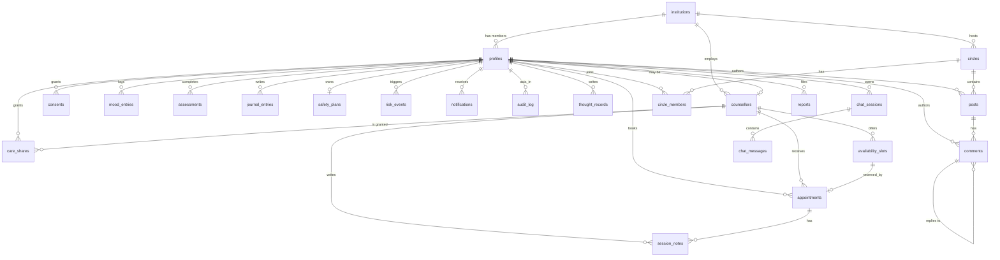

# Appendices

## Appendix A. Requirements traceability (summary)

The full matrix is docs/02-srs.md section 6 (48 functional rows and 17 non-functional rows; the rows are not copied here, to avoid divergence). Summary at the snapshot of 20 November 2026 (`node scripts/req-status.mjs`): 53 functional requirements (Implemented 2, Partial 49, Not started 2) and 19 non-functional (Implemented 1, Partial 11, Not started 7). The earlier hand count of 48 functional requirements (7, 39, 2) overstated and was replaced; see Chapter 3. Path shorthand used in that matrix: `S:` is `src/`, `F:` is `src/features/`, `L:` is `src/shared/lib/api/`, `D:` is `src/domain/`, `SB:` is `supabase/`, `M0001` to `M0008` are the migrations, and `EF:` is `supabase/functions/server/index.tsx`.

[STUDENT: regenerate the matrix with a script against the current 818-test suite (`node scripts/req-status.mjs` reports 72 requirements: Implemented 3, Partial 60, Not started 9) and paste a table of requirement, implementation, test and status.]

## Appendix B. Entity relationships

The attribute-level diagram is in docs/04-erd.md section 1. Figure 10 reproduces its relationship structure for the original 24 tables; the four tables added by migration 0005 (`institution_backup_counsellors`, `risk_followups`, `risk_checkback_prompts`, `risk_checkbacks`) are in docs/04-erd.md (the `rate_limits` table has no relationships and `reports.resource_id` is a free-text reference).

**Figure 10. Entity relationships** (source: docs/04-erd.md; relationship lines only; not yet rendered)



**Enumerated types.** `user_role`: student, counsellor, moderator, institution_admin, super_admin. `consent_purpose`: data_processing, crisis_intervention, analytics, counsellor_sharing, peer_support, research. `assessment_instrument`: phq9, gad7, phq4. `risk_severity`: low, medium, high, crisis. `risk_trigger`: phq9_item9, chat_crisis, lexicon_match, manual, assessment_escalation. `appointment_status`: scheduled, confirmed, completed, cancelled. `moderation_status`: pending, approved, flagged, rejected.

**Database objects of note.** Triggers: `on_auth_user_created` (alias profile), `trg_prevent_consents_tampering`, `trg_prevent_audit_log_tampering`, `trg_audit_care_shares`, `trg_assessment_crisis`. Functions: `book_appointment_atomic()`, `check_rate_limit()`, `purge_expired_chat_messages()`, `get_institution_wellbeing_summary()`, `has_active_care_share()`, `is_moderator()`. Views: the three institution aggregates.

## Appendix C. Consent form and study protocol

The consent form template, scenario tasks T1 to T7, the SUS procedure and the analysis plan are in docs/09-ethics-and-study-protocol.md. They are drafts for committee submission. [STUDENT: attach the signed-off versions, the approval letter and a blank copy of each instrument.]

## Appendix D. SUS and scenarios

[STUDENT: insert the SUS instrument as used (verify wording against the original [S29] **[VERIFY]**), the raw anonymised responses, the computed scores and the task success table.]

## Appendix E. Dataset card (summary)

Source: `eval/dataset/README.md`. Contents: 600 synthetic messages, 200 each in English, Devanagari Hindi and Hinglish; five labels (none, low, moderate, high, imminent) with 120 items each; 14 hand-written core sentences per language and label cell expanded to 40 with neutral openers or closers; development split 301 and held-out split 299, grouped by base sentence; one author and annotator; no clinical review; no method detail; no real user text.

**Reproduction.** From the project root:

```powershell
npx vitest run --coverage
node scripts/eval-llm.ts --limit 20      # needs ANTHROPIC_API_KEY
node scripts/eval-llm.ts
node scripts/eval-hybrid.ts --reuse-llm
node scripts/eval-report.ts
```

The last four commands have not been run against the real Claude API by the project; the scripts were verified against a mock server only.

## Appendix F. Helplines used by the application

| Service | Number | Operator and notes |
|---|---|---|
| Tele-MANAS | 14416, also 1800-891-4416 | Ministry of Health and Family Welfare, 24/7; described as available in 20 or more languages **[VERIFY]** |
| KIRAN | 1800-599-0019 | Department of Empowerment of Persons with Disabilities, 24/7 **[VERIFY]** |
| Emergency | 112 | National emergency number **[VERIFY]** |

All three must be verified against official sources before every release. They are defined once in `MANDATORY_HELPLINES` in `src/domain/risk/riskRouting.ts`.

## Appendix G. Test inventory (current totals; per-file counts are from the earlier 345-test run)

**Current totals (measured 2026-11-20).** Vitest: 71 files passed and 1 skipped (a live smoke test that needs tokens); 818 tests passed and 1 skipped. Coverage: statements 88.62%, branches 80.56%, functions 86.44%, lines 90.61%, with thresholds enforced in `vitest.config.ts`. Playwright default run (`npx playwright test`): 102 passed, 93 in the chromium project (57 of them accessibility combinations: 14 routes, light and dark, widths 1280 and 375, zero serious or critical violations, plus journeys, smoke and offline-ui specs) and 9 in the pwa project. Real-backend project (`pnpm test:e2e:real`, needs the local Supabase stack): 5 passed (sign-in and route sweep, crisis follow-through loop with security attempts, offline mood and crisis outbox, shared-device case). Chromium only; Firefox, WebKit and real-device PWA installation were not tested. pgTAP on a local Postgres (Supabase CLI, Docker): 14 files (`supabase/tests/01` to `14`), 146 tests, all passing, against migrations 0001 to 0008. TypeScript 0 errors; ESLint on `src` 0 errors and 0 warnings.

**Per-file counts (from the earlier 345-test run, now stale).** Largest files at that run: `lexicon.v2.test.ts` 68, `lexicon.test.ts` 25, `Community.test.tsx` 21, `journalCrypto.test.ts` 15, `phq9.test.ts` 15, `Doctors.test.tsx` 15, `phq4.test.ts` 14, `riskRouting.test.ts` 12, `api.test.ts` 11, `Chat.test.tsx` 11, `gad7.test.ts` 10. Counts for files added or changed since then have not been recorded here. [TODO: regenerate the per-file table from `.vitest/json/output.json`.] End-to-end specs: `e2e/smoke.spec.ts`, `journeys.spec.ts`, `a11y.spec.ts`, `pwa.spec.ts`, `offline-ui.spec.ts`, and the opt-in `e2e/real/*.spec.ts`. Complete inventory: docs/18-testing-report.md section 1.5.

Not run: Lighthouse, OWASP ZAP, any hosted Supabase project, the Anthropic chat route, Daily.co video, and the CI workflows on a real runner.
## Appendix H. Other documents

User manual (docs/16-user-manual.md), deployment guide (docs/17-deployment-guide.md), demo script (docs/14-demo-script.md), risk register (docs/12-risk-register.md) and roadmap (docs/15-roadmap.md) are part of the submission. [STUDENT: update the risk register with the actual state of each risk and attach screenshots of the running application in day and night mode, English and Hindi. None exist yet.]

## Appendix I. Evidence checklist

Only the student can supply these items.

- [ ] Survey instrument and anonymised responses with ethics clearance.
- [ ] Interview guide, consent forms and themes.
- [ ] Usability study with SUS scores and task success.
- [ ] Clinical or counselling advisor review note and sign-off.
- [ ] Ethics approval or exemption letter.
- [ ] Verified reference list (every [VERIFY] resolved).
- [ ] LLM-only and hybrid evaluation outputs.
- [ ] pgTAP, Lighthouse, ZAP and dependency audit outputs.
- [ ] Screenshots, rendered diagrams, declaration and acknowledgements.
- [ ] Supervisor sign-off.

## Appendix J. Glossary

**Alias.** Pseudonymous display name created on signup. **Care share.** A student-granted, revocable permission for one counsellor to read defined data. **Item 9.** PHQ-9 question about thoughts of being better off dead or of self-harm. **Hinglish.** Hindi in Latin script mixed with English. **k-anonymity.** Withholding any aggregate group smaller than k. **RLS.** Row level security in Postgres. **TTFT.** Time to first streamed token.

## References

[STUDENT: the reference list is intentionally empty. Every candidate in Chapter 2 is unverified. Add only sources that have been located and read.]
